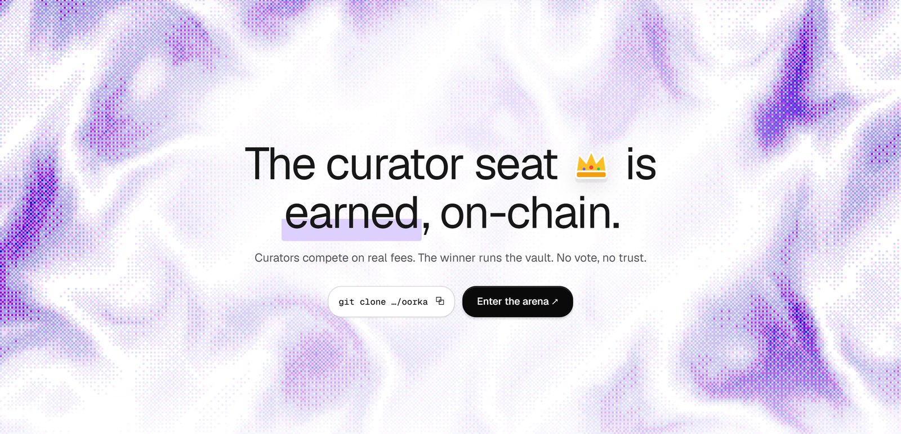
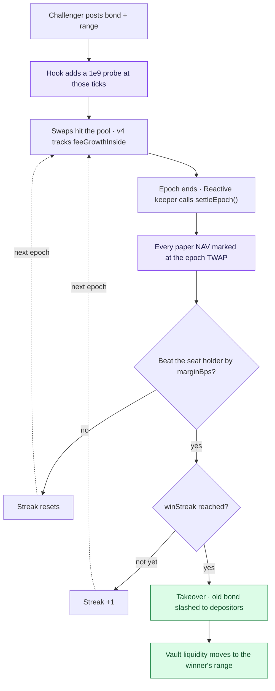
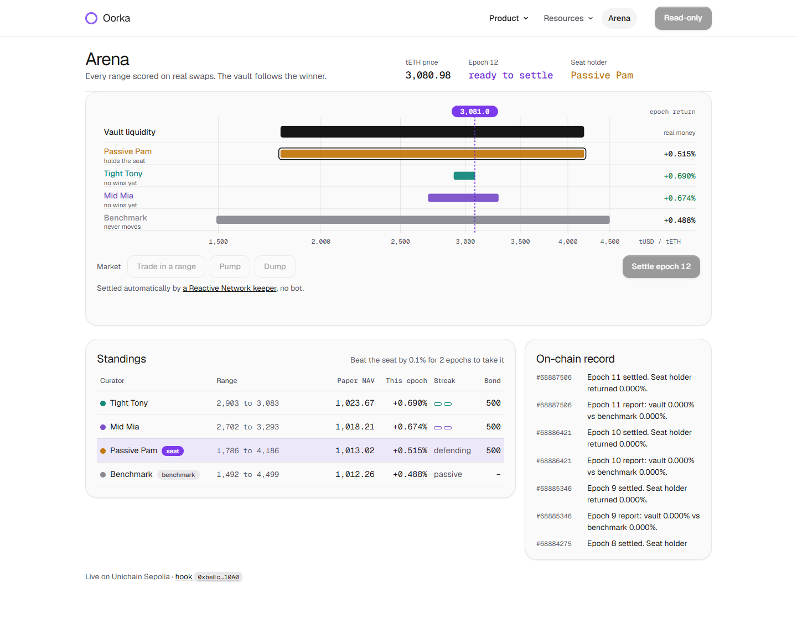
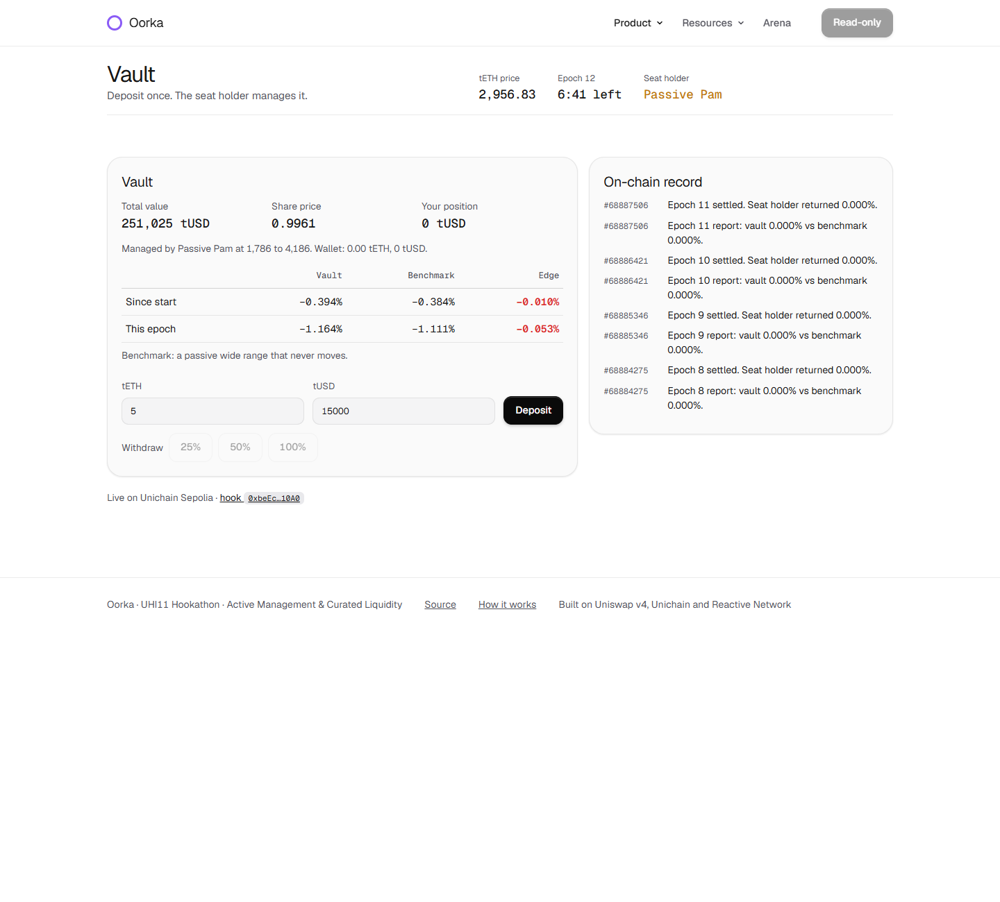
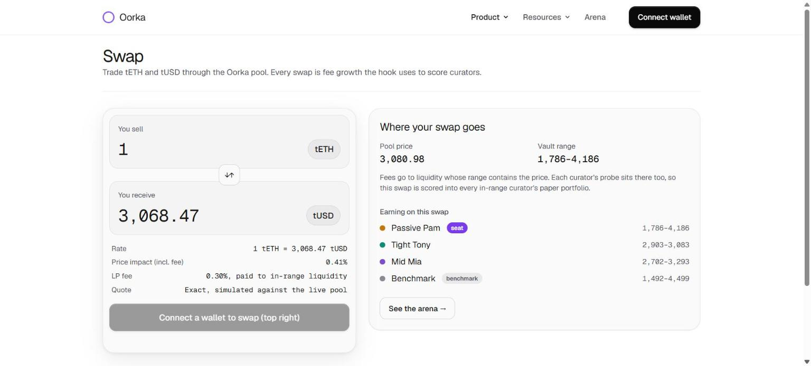
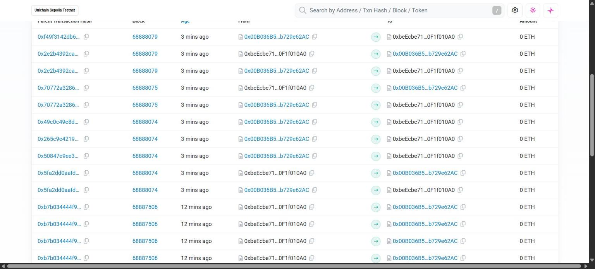
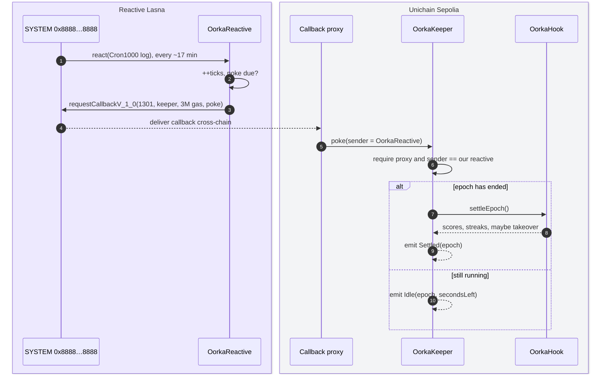
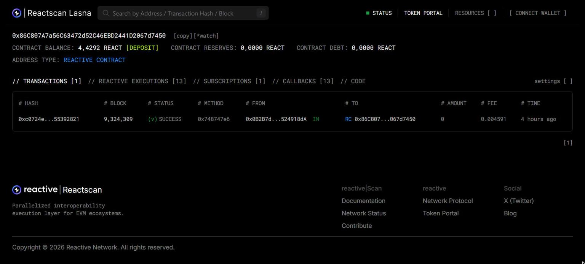
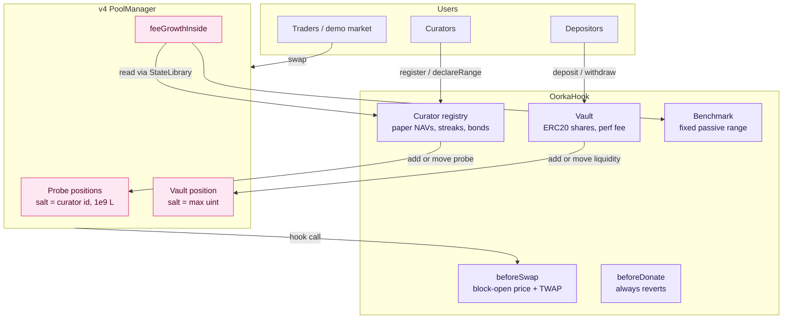
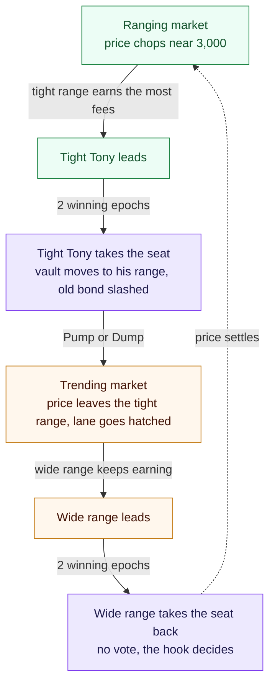

<div align="center">


# Oorka


**Curators compete on real fees. The winner runs the vault. No vote, no trust.**

A Uniswap v4 hook where the right to manage a vault's liquidity is won, and kept, on measured performance.

[](https://github.com/debojyoti10CC/oorka/actions/workflows/ci.yml)
[](https://github.com/debojyoti10CC/oorka/actions/workflows/market.yml)


[**Live app**](https://oorka.djyo.tech) · [**Arena**](https://oorka.djyo.tech/#/arena) · [**Docs**](https://oorkadocs.djyo.tech) · [**Hook on Uniscan**](https://sepolia.uniscan.xyz/address/0xbeEcbe71d831880f2038Bc35b613e100F1f010A0) · [**Run it locally**](#run-it)

<sub>UHI11 Hookathon · Active Management & Curated Liquidity</sub>

<a href="https://debojyoti10cc.github.io/oorka/"></a>

</div>

---

## The problem

Curated LP vaults ask depositors to trust a manager. You pick one on marketing, or on a backtest they ran themselves over data they chose. Nothing on-chain says *"this manager is actually better than the alternatives right now"*, and nothing replaces a bad one without governance drama.

## How it works

1. **Declare.** A challenger posts a bond and names a range. The hook adds a **dust probe** (`1e9` liquidity) at those ticks. v4 only tracks `feeGrowthInside` for initialised ticks, so now the PoolManager itself measures what that range earns, swap by swap.
2. **Score.** Every curator gets a **paper portfolio** of 1,000 tUSD of virtual liquidity at their range: real fees from the probe, plus real price exposure. At each epoch end the portfolios are marked at the epoch's **time-weighted** price and compared with each other and with a passive **benchmark**.
3. **Take over.** Beat the seat holder by `marginBps` for `winStreak` epochs in a row and the vault's **real** liquidity moves to your range in the same transaction. The old seat holder's bond is slashed to depositors.

The seat holder is scored exactly like everyone else, so the race is apples to apples. Nobody runs it: a **Reactive Network** CRON contract settles every epoch on its own.



## Why Oorka

<table>
<tr>
<td width="25%" align="center"><h2>46</h2><sub>Foundry tests + 5 invariants, green in CI</sub></td>
<td width="25%" align="center"><h2>0</h2><sub>oracles, owners, admin keys or off-chain services</sub></td>
<td width="25%" align="center"><h2>1e9</h2><sub>liquidity per probe: dust, but v4 tracks fees there</sub></td>
<td width="25%" align="center"><h2>10%</h2><sub>seat holder's cut, only above the benchmark and high-water mark</sub></td>
</tr>
</table>

- **Proof, not a pitch deck.** Every score comes from v4's own `feeGrowthInside` at the declared ticks. Nobody self-reports a backtest; the pool measures the forward test.
- **Earn the seat, earn the fee.** The seat holder is paid 10% of the value created above a passive benchmark and the high-water mark. Nothing for losses, nothing for doing what doing nothing would do.
- **Hard to game.** Settlement prices at the epoch's time-weighted average, donations revert, vault moves wait for an honest price.
- **Nobody runs it.** A Reactive Network CRON contract settles every epoch. Takeover and vault migration happen in one transaction.

| | Typical vault manager | Auction-managed AMM | **Oorka** |
|---|---|---|---|
| Who gets the seat | Whoever launched the vault | Highest rent bidder | **Best measured LP performance** |
| Evidence | Self-reported backtest | Willingness to pay | **v4 fee growth at the declared ticks** |
| Replacing a bad manager | Governance or withdraw | Outbid them | **Automatic after a win streak** |
| Manager pay | Flat fee | Keeps arbitrage | **10% above benchmark + high-water** |

---

## Live on testnet

<table>
<tr>
<td width="50%"><a href="https://debojyoti10cc.github.io/oorka/#/arena"></a><p align="center"><b>Arena</b>: lanes, standings, the on-chain record</p></td>
<td width="50%"><a href="https://debojyoti10cc.github.io/oorka/#/vault"></a><p align="center"><b>Vault</b>: deposit, withdraw, vault vs benchmark</p></td>
</tr>
<tr>
<td width="50%"><a href="https://debojyoti10cc.github.io/oorka/#/swap"></a><p align="center"><b>Swap</b>: exact quotes from the live pool, and which curators your fee scores</p></td>
<td width="50%"><a href="https://sepolia.uniscan.xyz/address/0xbeEcbe71d831880f2038Bc35b613e100F1f010A0#internaltx"></a><p align="center"><b>Uniscan</b>: the hook's on-chain activity</p></td>
</tr>
</table>

| Contract | Chain | Address |
|---|---|---|
| **OorkaHook** (hook + vault + curator registry) | Unichain Sepolia | [`0xbeEcbe71d831880f2038Bc35b613e100F1f010A0`](https://sepolia.uniscan.xyz/address/0xbeEcbe71d831880f2038Bc35b613e100F1f010A0) |
| **OorkaKeeper** (Reactive callback, settles epochs) | Unichain Sepolia | [`0x53b31469cf03ae9f0042c7d6cbeed46750e22da5`](https://sepolia.uniscan.xyz/address/0x53b31469cf03ae9f0042c7d6cbeed46750e22da5) |
| **OorkaReactive** (CRON subscriber) | Reactive Lasna | [`0x86c807a7a56c63472d52c46ebd2441d2067d7450`](https://lasna.reactscan.net/address/0x86c807a7a56c63472d52c46ebd2441d2067d7450) |
| Uniswap v4 PoolManager | Unichain Sepolia | [`0x00b036b58a818b1bc34d502d3fe730db729e62ac`](https://sepolia.uniscan.xyz/address/0x00b036b58a818b1bc34d502d3fe730db729e62ac) |
| tETH / tUSD test tokens | Unichain Sepolia | [`0x64A3…10e6`](https://sepolia.uniscan.xyz/address/0x64A3C35b31f04e3c92a45E9d003468e4574810e6) / [`0xaCB1…Ac5C`](https://sepolia.uniscan.xyz/address/0xaCB1732744aa55ff155E9BCA3F5B809b60C1Ac5C) |

- **The pool** is tETH/tUSD at about 3,000, seeded with three curators (Passive Pam holds the seat, Tight Tony, Mid Mia), the benchmark and a vault deposit.
- **Epochs** last 15 minutes. The Reactive CRON contract (Cron1000) pokes the keeper about every 17 minutes, so every ended epoch settles within one tick, with nobody clicking anything.
- **A demo market** ([`market.yml`](.github/workflows/market.yml)) trades in the pool four times an hour with a throwaway key, walking the price through slow waves so tight and wide ranges take turns winning. It never settles: that is the keeper's job alone.
- Connect any browser wallet on the [live app](https://oorka.djyo.tech) (mirror: [GitHub Pages](https://debojyoti10cc.github.io/oorka/)). Test tokens are minted from the app. All addresses live in [`deployments.1301.json`](frontend/public/deployments.1301.json).

---

## Why it's hard to game

| Attack | Defense |
|---|---|
| Flash-swap the price to inflate your paper NAV right before settling | All accounting uses the **block-open price**, snapshotted in `beforeSwap` on the first swap of each block. An in-block push doesn't move it. |
| Push the price at the end of block N, settle first thing in block N+1 | Settlement scores at the epoch's **time-weighted average of block-open ticks** (`settleSqrtPrice()`), built inside the hook. A push held for seconds barely moves a 15-minute average. |
| Sandwich the vault while it rebalances, or deposit/withdraw at a pushed price | Vault-moving actions revert if spot is more than `maxTickDeviation` ticks from the block-open price. |
| Push the price, then call the permissionless `settleEpoch()` so a takeover migrates the vault into your sandwich | The seat still changes hands, but the vault only moves at an honest price. Otherwise it emits `VaultMoveDeferred` and the next settlement or `compound()` finishes the move. |
| Register and exit over and over until `settleEpoch()` runs out of gas | Exited slots are reused, so the curator array never exceeds 8 curators plus the benchmark. An invariant checks it. |
| Pump a range's score with `donate()`, which adds fee growth with no swap | The hook claims `beforeDonate` and reverts every donation (`DonationsDisabled`). |
| Declare a range after seeing where the price went | Ranges accrue only from the moment they're declared. No backdating. |
| Flip ranges every block to chase fees | Every range change charges `switchCostBps` on the paper portfolio. |
| Join late in an epoch with a lucky streak | A challenger must be present for the **whole** epoch to be eligible. |
| Spam the leaderboard | Bond required, max 8 curators. |
| Carry wins earned against the old seat holder into the new reign | All streaks reset on takeover. |

> **Known limitation.** A curator could wash-trade to inflate fee growth at their range. Unlike a donation it costs them the swap fee plus price impact, the fees go to *real* liquidity in that range, and every overlapping range benefits too. A production version would cap per-epoch fee credit or weight fees by unique swappers.

## Keeper-free settlement (Reactive Network)



- **`OorkaReactive`** subscribes to Reactive's built-in CRON event. The system contract (`0x8888…8888`) calls `react()` on every tick; every `ticksPerPoke` ticks it requests a callback to the hook's chain. An owner switch pauses and resumes the subscription.
- **`OorkaKeeper`** only accepts the Reactive callback proxy **and** only when the network-injected sender is our own `OorkaReactive`. Ended epoch → settle; otherwise `Idle`. A failed settle emits `SettleFailed` and retries next tick.
- The keeper has **no special rights** on the hook. It only adds liveness. A takeover settle uses under 1.5M gas, half the 3M callback budget (checked in the tests).

<a href="https://lasna.reactscan.net/address/0x86c807a7a56c63472d52c46ebd2441d2067d7450"></a>
<p align="center"><sub>OorkaReactive on Reactscan Lasna: every CRON tick executed and called back to the keeper, zero debt.</sub></p>

<details>
<summary><b>Deploy the keeper yourself</b></summary>

`frontend/scripts/deploy-reactive.mjs` runs all three steps from CI's build artifacts:

```bash
cd frontend
node scripts/deploy-reactive.mjs <contracts-out artifact dir>   # CRON=100 for ~2 min ticks, default Cron1000
```

or by hand with Foundry:

```bash
cd contracts
# 1. reactive contract on Lasna: Cron1000 (~17 min), poke every tick, destination chain 1301
forge create src/reactive/OorkaReactive.sol:OorkaReactive --broadcast --rpc-url https://lasna-rpc.rnk.dev/ --private-key $PRIVATE_KEY --value 0.35ether \
  --constructor-args 0xe20b31294d84c3661ddc8f423abb9c70310d0cf172aa2714ead78029b325e3f4 1301 1

# 2. keeper on the hook's chain: Unichain Sepolia's callback proxy, the reactive contract, the hook
forge create src/reactive/OorkaKeeper.sol:OorkaKeeper --broadcast --rpc-url https://sepolia.unichain.org --private-key $PRIVATE_KEY --value 0.003ether \
  --constructor-args 0x775c9B990ADe401060B78D0e98684eEf8d2466C1 $REACTIVE $HOOK false

# 3. point the reactive contract at the keeper
cast send $REACTIVE "setKeeper(address)" $KEEPER --rpc-url https://lasna-rpc.rnk.dev/ --private-key $PRIVATE_KEY
```

Every CRON tick is billed whether or not anything happens, so pick the longest interval that fits the epoch, and use `setPaused(true)` to stop it. Callback proxies and CRON topics come from the [Reactive docs](https://dev.reactive.network/origins-and-destinations).

</details>

---

## Under the hood

**Hook permissions:** `afterInitialize` (bind to one pool), `beforeSwap` (snapshot the block-open price, build the TWAP) and `beforeDonate` (reject donations). The hook never touches swap pricing, so traders pay normal v4 fees.



**Positions inside the PoolManager**, all owned by the hook and separated by salt:

| salt | what |
|---|---|
| `bytes32(id)` | curator `id`'s probe, `1e9` liquidity at their declared range |
| `type(uint256).max` | the vault's real liquidity at the seat holder's range |

**Paper NAV (per curator):**

```
fees     = (feeGrowthInside_now − feeGrowthInside_last) · vL / 2^128
position = amounts(vL, range, blockOpenPrice)
NAV      = value(position + fees + cash, blockOpenPrice)        // in tUSD
```

`vL` (virtual liquidity) is set so the portfolio is worth exactly its NAV when the range is declared. A range change re-derives `vL` from the current NAV minus the switch cost.

**Performance fee.** The seat holder earns `perfFeeBps` (10%) of vault growth **above the benchmark and the high-water mark**, minted as shares. Nothing for losses; nothing for matching doing nothing.

<details>
<summary><b>Key functions</b></summary>

| function | who | what |
|---|---|---|
| `register(name, lower, upper, bond)` | anyone | enter. The first registrant takes the seat. |
| `declareRange(id, lower, upper)` | curator | move your range. The seat holder's move also moves the vault. |
| `settleEpoch()` | anyone (the keeper) | score, update streaks, hand over the seat if earned |
| `deposit / withdraw` | depositors | ERC20 vault shares priced at the block-open price |
| `exit(id)` | challenger | leave and reclaim your bond |
| `compound()` | anyone | reinvest collected fees, finish a deferred vault move |
| `registerBenchmark(name, lower, upper)` | anyone, once | the passive reference range. No owner, no bond, never competes. |
| `benchmarkReport()` | view | vault vs benchmark growth, since start and this epoch |

</details>

<details>
<summary><b>Repository layout</b></summary>

```
contracts/
  src/OorkaHook.sol              the hook, the vault (ERC20 shares) and the curator registry, in one contract
  src/reactive/                  OorkaReactive (Reactive CRON) + OorkaKeeper (callback, settles epochs)
  test/                          46 Foundry tests + 5 invariants
  script/DeployLocal.s.sol       local world with seeded curators
  script/DeployTestnet.s.sol     deploy against a real v4 PoolManager
frontend/                        Vite + React + viem app (landing, arena, vault, curate, swap, docs)
  scripts/                       deploy-testnet, deploy-reactive, deploy-local, market (demo trader)
.github/workflows/               CI (forge build + test), Pages, Demo market
demo.sh                          one-command local demo
```

</details>

---

## Tests

**46 tests + 5 invariants, all green in CI.**

| Suite | What it proves |
|---|---|
| **Hook, unit** (31) | the probe measures fees without capital · first registrant takes the seat and the vault follows · takeover after the streak · streaks reset on takeover · slashed bond goes to depositors · a trending market favours the wide range · an out-of-range challenger never wins · in-block manipulation is ignored · the TWAP ignores a push across a block boundary but follows a sustained move · donations revert · performance fee only above the benchmark · the benchmark starts flat, can't move, exit or take the seat, and uses no curator slot · deposit/withdraw round trips · bond, range and access-control reverts · churn reuses slots · a takeover during a price push changes the seat and waits to move the vault |
| **Hook, fuzz** (2 × 256 runs) | a deposit/withdraw round trip can never create value · range validation holds for any tick pair |
| **Invariants** (5, 32 runs × 60 calls) | random trades, deposits, withdrawals, registrations, range changes, exits, time and settlements; after every step: the hook is **solvent** (idle balances + bonds), the vault's booked liquidity **equals the PoolManager's**, the curator array **stays bounded**, there is **exactly one live seat holder** (never the benchmark), every probe **sits at its declared range** |
| **Reactive keeper** (13) | no-op mid-epoch · settles an ended epoch · drives a full takeover alone · rejects foreign callers and foreign reactive contracts · only the system contract calls `react()` · callback carries the right chain, recipient, gas and payload · requests every N ticks · waits for the keeper to be set · pays only the system contract / proxy · pause unsubscribes, resume covers debt · ignores other topics · settle fits the callback gas budget |

```bash
cd contracts && forge test
```

---

## Run it

Needs [Foundry](https://book.getfoundry.sh/getting-started/installation) and Node 18+.

```bash
./demo.sh        # anvil + PoolManager + tokens + hook + seeded curators + frontend → http://localhost:5173
```

<details>
<summary><b>Windows, Node-only, and testnet options</b></summary>

**Windows:** run `./demo.sh` from WSL, or run `anvil --host 0.0.0.0` and the deploy steps in WSL and start the frontend from Windows (`cd frontend && npm install && npx vite`). The RPC comes from `VITE_RPC_URL` (default `http://127.0.0.1:8545`).

**Without Foundry (Node only):** a Hardhat devnet plays anvil's role and the contracts come prebuilt from CI:

```bash
cd local-chain && npm install && npm run node                                   # devnet on :8545
gh run download -R debojyoti10CC/oorka -n contracts-out -D ../ci-out             # second terminal
cd frontend && npm install && node scripts/deploy-local.mjs ../ci-out
npx vite --mode hardhat
```

The local frontend signs with dev keys, so there's no wallet popup. Use **Acting as** to switch between the depositor, fresh challengers and the seeded curators.

**Against the live testnet deployment:**

```bash
cd frontend && npm install && npx vite --mode unichain
```

**Your own testnet deployment:**

```bash
cd contracts
PRIVATE_KEY=0x... POOL_MANAGER=0x00b036b58a818b1bc34d502d3fe730db729e62ac \
forge script script/DeployTestnet.s.sol --rpc-url https://sepolia.unichain.org --broadcast
```

</details>

**What to try:** hit **Trade in a range** a few times and the tight curator out-earns the wide one on fees. Settle a few epochs and watch the seat change hands and the vault bar slide to the new range. Then **Pump**: the price leaves the tight range, its lane goes hatched, and the wide range leads. The market decides who should manage; the hook works it out alone.



---

## Partner integrations

| Partner | What it does in Oorka | Where |
|---|---|---|
| **Reactive Network** | Keeper-free epoch settlement: a CRON-driven reactive contract calls back to a keeper that settles ended epochs. | [`OorkaReactive.sol`](contracts/src/reactive/OorkaReactive.sol) · [`OorkaKeeper.sol`](contracts/src/reactive/OorkaKeeper.sol) · [`OorkaReactive.t.sol`](contracts/test/OorkaReactive.t.sol) (13 tests) |

## Credits

The hook, vault, scoring, benchmark, settlement price and keeper were written for this project. They build on:

- **Uniswap v4** ([v4-core](https://github.com/Uniswap/v4-core), [v4-periphery](https://github.com/Uniswap/v4-periphery)): `PoolManager`, `StateLibrary`, `TickMath`, `SqrtPriceMath`, `LiquidityAmounts`, and the test helpers `Deployers`, `PoolSwapTest`, `PoolModifyLiquidityTest`.
- **solmate**: `ERC20` (vault shares) and `MockERC20` (test tokens).
- **Reactive Network**: system-contract and callback-proxy interfaces follow [reactive-lib-omni](https://github.com/Reactive-Network/reactive-lib-omni), implemented inline to stay on solc 0.8.26; the CRON pattern follows Reactive's [CRON demo](https://github.com/Reactive-Network/reactive-smart-contract-demos/tree/main/src/demos/cron).
- **Foundry**, **viem**, **React**, **Vite**, and **React Bits** [`<Dither />`](https://reactbits.dev) for the hero background (unmodified).


