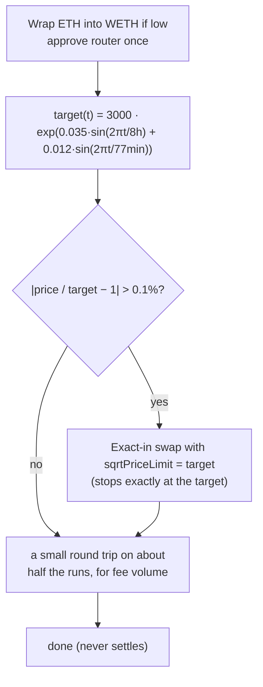

A testnet pool with no traders produces no fee growth and no price moves, so nothing would ever win. The market maker is a trader with its own wallet, USDC and WETH that trades the real pool, the same way any user can.

| | |
|---|---|
| Workflow | [`.github/workflows/market.yml`](https://github.com/debojyoti10CC/oorka/blob/main/.github/workflows/market.yml) |
| Script | [`frontend/scripts/market.mjs`](https://github.com/debojyoti10CC/oorka/blob/main/frontend/scripts/market.mjs) |
| Schedule | minutes 7, 22, 37, 52 of every hour, plus manual dispatch |
| Key | throwaway testnet key in the `TRADER_KEY` repository secret |

## One run

## Why a wave

- Near the middle of the slow 8-hour wave the price chops inside narrow ranges, so **tight curators** earn the most fees.
- At the swings the price leaves narrow ranges, so **wide curators** catch up.

That alternation produces real streaks and real takeovers on the live deployment.

<Note>The market never calls `settleEpoch()`. Settlement belongs to the Reactive keeper alone.</Note>
