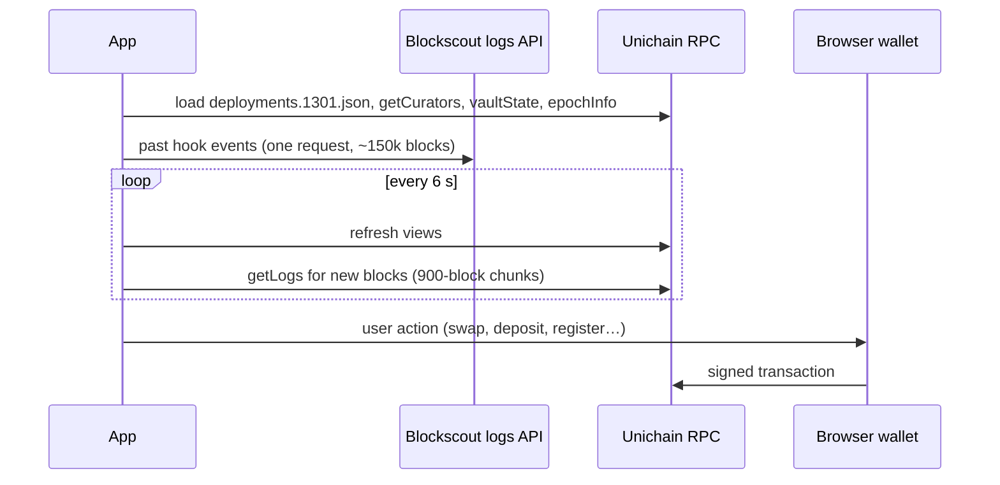

React 18, Vite and viem, no backend. Served from [debojyoti10cc.github.io/oorka](https://debojyoti10cc.github.io/oorka/).

## Pages

| Route | What it shows |
|---|---|
| `#/` | Landing page: dithered hero, how it works, why Oorka, numbers, comparison |
| `#/arena` | Lanes chart of every range around the live price, market controls, settle button, standings, on-chain record |
| `#/vault` | Deposit and withdraw, vault vs benchmark |
| `#/curate` | Register, change range, exit |
| `#/swap` | Exact quotes against the live pool, which curators the swap scores |
| `#/docs` | In-app explainer with figures |

<Frame caption="The Arena: vault liquidity, each curator's range, the benchmark and the live price.">
  
</Frame>

## Reading the lanes

| Visual | Meaning |
|---|---|
| Black bar | The vault's real liquidity |
| Outlined bar | The seat holder's range |
| Hatched bar | Range is out of the current price and earning nothing |
| Pips | Win streak toward `winStreak` |
| Right column | This epoch's return |

## Data flow

## Modes

| Mode | How | Chain | Signing |
|---|---|---|---|
| Local (anvil) | `npm run dev` | 31337, `127.0.0.1:8545` | anvil dev keys, **Acting as** switcher, time controls |
| Hardhat | `npx vite --mode hardhat` | Hardhat devnet | dev keys |
| Testnet | `npx vite --mode unichain`, or any production build | Unichain Sepolia 1301 | browser wallet |

Production builds (`npm run build`, Vercel) read `frontend/.env.production` and target the testnet.
