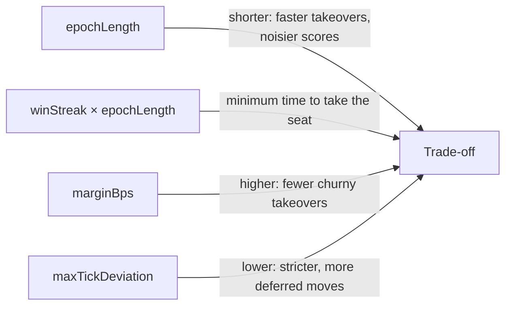

Configuration is fixed at deployment. There is no owner and no setter.

```solidity
struct Config {
    uint64 epochLength;     // seconds
    uint32 winStreak;       // consecutive winning epochs needed to take over
    uint32 marginBps;       // challenger must beat incumbent growth by this many bps
    uint32 switchCostBps;   // paper cost charged on every range change
    uint32 slashBps;        // share of a dethroned incumbent's bond paid to depositors
    int24  maxTickDeviation;// max |spot tick − reference tick| for vault-moving actions
    uint256 minBond;        // in token1
    uint32 perfFeeBps;      // seat holder's cut of vault value above benchmark and high-water mark
}
```

| Parameter | Testnet | Local demo | Effect |
|---|---|---|---|
| `epochLength` | 900 s (15 min) | 1 h | Scoring period |
| `winStreak` | 2 | 2 | Wins in a row to take the seat |
| `marginBps` | 10 (0.1%) | 10 | Required lead over the seat holder |
| `switchCostBps` | 30 (0.3%) | 30 | Paper cost per range change |
| `slashBps` | 2000 (20%) | 2000 | Dethroned bond paid to depositors |
| `maxTickDeviation` | 300 | 200 | Price-push tolerance for vault moves |
| `minBond` | 100 tUSD | 100 tUSD | Entry bond |
| `perfFeeBps` | 1000 (10%) | 1000 | Seat holder's cut above the hurdle |

## Constants

| Constant | Value | Purpose |
|---|---|---|
| `INITIAL_NAV` | 1,000e18 | Starting paper portfolio (tUSD) |
| `PROBE_LIQUIDITY` | 1e9 | Dust liquidity per probe |
| `MAX_CURATORS` | 8 | Active curators, excluding the benchmark |
| `MIN_SHARES` | 1,000 | Shares burned to `0xdead` on first deposit |
| `VAULT_SALT` | `type(uint256).max` | Vault position salt |

## Choosing values


