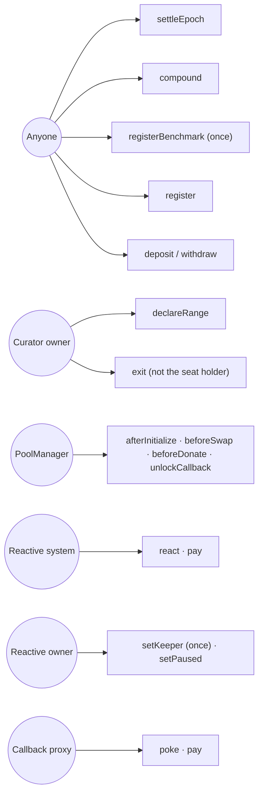

| Contract | Chain | Source | Size |
|---|---|---|---|
| `OorkaHook` | Unichain Sepolia | [`contracts/src/OorkaHook.sol`](https://github.com/debojyoti10CC/oorka/blob/main/contracts/src/OorkaHook.sol) | 1,028 lines, 24,358 bytes runtime |
| `OorkaReactive` | Reactive Lasna | [`contracts/src/reactive/OorkaReactive.sol`](https://github.com/debojyoti10CC/oorka/blob/main/contracts/src/reactive/OorkaReactive.sol) | 167 lines |
| `OorkaKeeper` | Unichain Sepolia | [`contracts/src/reactive/OorkaKeeper.sol`](https://github.com/debojyoti10CC/oorka/blob/main/contracts/src/reactive/OorkaKeeper.sol) | 94 lines |

Compiler: solc `0.8.26`, Cancun EVM. Dependencies: Uniswap v4-core and v4-periphery, solmate.

## Access map

<CardGroup cols={3}>
  <Card title="OorkaHook" icon="anchor" href="/contracts/oorka-hook">Functions, views, structs.</Card>
  <Card title="Events and errors" icon="list" href="/contracts/events-and-errors">Everything the hook emits or reverts with.</Card>
  <Card title="Configuration" icon="sliders-horizontal" href="/contracts/configuration">Constructor parameters and constants.</Card>
  <Card title="OorkaReactive" icon="radio" href="/contracts/oorka-reactive">CRON subscriber on Lasna.</Card>
  <Card title="OorkaKeeper" icon="timer" href="/contracts/oorka-keeper">Callback receiver on Unichain.</Card>
  <Card title="Addresses" icon="map-pin" href="/contracts/addresses">Every deployed address.</Card>
</CardGroup>
