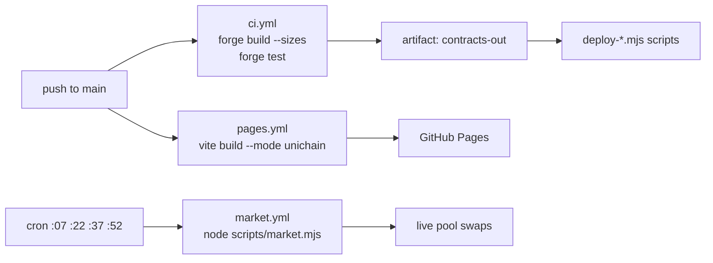

| Workflow | Trigger | Does |
|---|---|---|
| `ci.yml` | push, pull request | Installs Foundry and dependencies, builds with sizes, runs every test, uploads `contracts-out` |
| `pages.yml` | push to main | Builds the frontend in testnet mode with base `/oorka/` and deploys to GitHub Pages |
| `market.yml` | cron four times an hour, manual | Runs the demo trader with `TRADER_KEY` |

## Why CI builds the contracts

The development machine can't run Foundry binaries, so CI is the build system. Deploy scripts are plain Node + viem and read bytecode from the `contracts-out` artifact:

```bash
gh run download -R debojyoti10CC/oorka -n contracts-out -D ci-out
```
