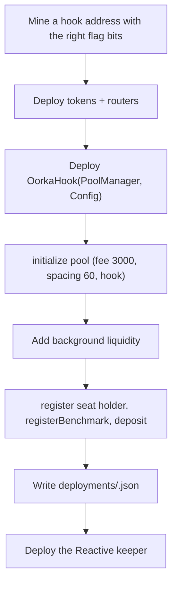

<Tabs>
  <Tab title="Foundry script">
    ```bash
    cd contracts
    PRIVATE_KEY=0x... \
    POOL_MANAGER=0x00b036b58a818b1bc34d502d3fe730db729e62ac \
    forge script script/DeployTestnet.s.sol --rpc-url https://sepolia.unichain.org --broadcast
    ```

    The script header also lists PoolManager addresses for Sepolia, Base Sepolia and Arbitrum Sepolia.
  </Tab>
  <Tab title="Node script">
    ```bash
    gh run download -R debojyoti10CC/oorka -n contracts-out -D ci-out
    cd frontend
    PRIVATE_KEY=0x... node scripts/deploy-testnet.mjs ../ci-out
    ```

    Writes `public/deployments.1301.json`, which the app reads.
  </Tab>
</Tabs>

Then [deploy the keeper](/keeper/deploy).

## Hosting the app

| Target | How |
|---|---|
| GitHub Pages | Automatic on push (`pages.yml`) |
| Vercel / any static host | Root `frontend`, build `npm run build`, output `dist`. `.env.production` points it at the testnet. |
