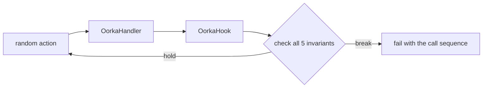

```bash
cd contracts && forge test
```

<CardGroup cols={3}>
  <Card title="31" icon="flask-conical">hook unit tests</Card>
  <Card title="2" icon="shuffle">fuzz tests × 256 runs</Card>
  <Card title="5" icon="infinity">invariants, 32 runs × depth 60</Card>
  <Card title="13" icon="timer">Reactive keeper tests</Card>
  <Card title="15" icon="activity">Oorka Pulse tests</Card>
</CardGroup>

## Hook: core mechanism

| Test | Proves |
|---|---|
| `test_probeMeasuresFeesWithoutCapital` | A 1e9 probe yields real fee growth for its range |
| `test_firstRegistrantIsIncumbentAndVaultFollows` | First curator takes the seat; vault placed at their range |
| `test_vaultEarnsRealFees` | Vault position earns swap fees |
| `test_challengerTakesOverAfterStreak` | Two qualifying wins hand over the seat |
| `test_takeoverResetsEveryStreak` | All streaks reset on takeover |
| `test_dethronedIncumbentIsSlashedToDepositors` | 20% of the old bond goes to the vault |
| `test_trendingMarketFavorsWideRange` | A trend makes the wide range win |
| `test_outOfRangeChallengerNeverWins` | An out-of-range curator can't win |
| `test_incumbentRebalanceMovesVault` | Seat holder's range change moves real liquidity |
| `test_challengerRangeChangeDoesNotTouchVault` | A challenger's change never moves the vault |

## Hook: manipulation resistance

| Test | Proves |
|---|---|
| `test_referencePriceIgnoresInBlockManipulation` | Block-open price ignores in-block pushes |
| `test_settlePriceIgnoresAPushAcrossTheBlockBoundary` | TWAP shrugs off a push held for seconds |
| `test_settlePriceFollowsASustainedMove` | TWAP still tracks real moves |
| `test_donationsAreBlocked` | `donate()` reverts |
| `test_takeoverWaitsOutAPricePush` | Seat changes during a push; vault waits |
| `test_registerExitChurnReusesSlots` | Churn can't grow the curator array |
| `test_cannotSettleEarly` | `EpochNotOver` |

## Hook: benchmark and fee

| Test | Proves |
|---|---|
| `test_seatHolderIsPaidOnlyForBeatingTheBenchmark` | Fee only on excess over the benchmark |
| `test_noFeeWhenTheBenchmarkWins` | No fee when the benchmark does better |
| `test_noFeeWithoutABenchmarkOnFlatEpoch` | No fee on a flat epoch |
| `test_benchmarkStartsFlatAndIsImmovable` | Benchmark can't move |
| `test_onlyOneBenchmark` | `BenchmarkExists` |
| `test_benchmarkNeverTakesTheSeat` | Benchmark never seated |
| `test_benchmarkReportTracksVaultAndBenchmark` | `benchmarkReport` correct |
| `test_benchmarkDoesNotUseACuratorSlot` | 8 curators still allowed |

## Hook: vault, access control, fuzz

| Test | Proves |
|---|---|
| `test_depositWithdrawRoundTrip` | Round trip returns funds |
| `test_exitReturnsBond` | Bond refunded |
| `test_incumbentCannotExit` | `IsIncumbent` |
| `test_onlyOwnerDeclares` | `NotCuratorOwner` |
| `test_bondTooSmall` | `BondTooSmall` |
| `test_badRangeReverts` | `BadRange` |
| `testFuzz_depositWithdrawNeverCreatesValue` | Any deposit + withdraw never returns more than put in |
| `testFuzz_rangeRulesHold` | Range validation holds for any tick pair |

## Invariants

The handler (`OorkaHandler`) drives 4 actors through bounded random actions: `trade` (weighted ×2), `nextBlock`, `deposit`, `withdraw`, `register`, `declare`, `exitArena`, `settle`. A reverting call is skipped like a failed transaction. Setup seeds a seat holder, a benchmark and a vault deposit so every path is reachable.



| Invariant | Statement |
|---|---|
| `invariant_solvent` | token0 balance ≥ idle0; token1 balance ≥ idle1 + all bonds |
| `invariant_vaultLiquidityMatchesPoolManager` | booked vault liquidity = PoolManager position liquidity |
| `invariant_curatorArrayBounded` | `curatorCount() ≤ MAX_CURATORS + 1` |
| `invariant_seatHolderIsALiveCurator` | exactly one seat holder, active, not the benchmark |
| `invariant_probesTrackDeclaredRanges` | each active probe holds exactly `PROBE_LIQUIDITY` at its range |

Settings in `foundry.toml`: `[fuzz] runs = 256`, `[invariant] runs = 32, depth = 60, fail_on_revert = false`.

## Reactive keeper

| Test | Proves |
|---|---|
| `test_pokeIsANoOpMidEpoch` | Mid-epoch poke only emits `Idle` |
| `test_pokeSettlesAnEndedEpoch` | Ended epoch is settled |
| `test_takeoverHappensWithNoHumanSettling` | Full takeover via keeper; settle < 1.5M gas |
| `test_onlyCallbackProxy` | Foreign callers rejected |
| `test_onlyOurReactiveContract` | Foreign reactive contracts rejected |
| `test_keeperPaysOnlyTheProxy` | Keeper funds only go to the proxy |
| `test_reactiveSubscribesToCronOnDeploy` | Subscription at construction |
| `test_reactiveRequestsCallbackEveryNTicks` | Correct chain, recipient, gas, payload, cadence |
| `test_reactOnlyFromSystem` | Only the system contract calls `react` |
| `test_reactiveWaitsForKeeper` | No callbacks before `setKeeper` |
| `test_reactivePaysTheSystemContract` | Payments only to the system contract |
| `test_pauseUnsubscribesAndResumeCoversDebt` | Pause / resume semantics |
| `test_reactiveIgnoresOtherTopics` | Unrelated logs ignored without reverting |

A mock system contract is etched at `0x8888…8888` to stand in for Reactive's VM.

## Oorka Pulse

| Test | Proves |
|---|---|
| `test_subscribesToSwapsAndHookEventsOnDeploy` | Four subscriptions: pool `Swap`, `EpochSettled`, `VaultMoveDeferred`, `VaultMoved` |
| `test_swapMidEpochDoesNothing` | No callback while the epoch is running |
| `test_firstSwapAfterEpochEndRequestsACallback` | Callback with chain 1301, the keeper, 3M gas; `Triggered` carries the origin block and tx |
| `test_fullLoopSettlesInTheSameSecond` | Swap log, callback, keeper settles: the seat changes at the epoch boundary with no CRON wait |
| `test_cooldownStopsABurst` | Ten swaps produce one callback; a retry after the cooldown |
| `test_epochSettledResetsTheClock` | `EpochSettled` moves the due time forward one epoch |
| `test_deferredMoveIsFinishedOnTheNextSwap` | `VaultMoveDeferred` then a swap: the keeper calls `compound()` |
| `test_vaultMovedClearsThePendingFlag` | `VaultMoved` clears the flag; no callback |
| `test_ignoresOtherPoolsChainsAndContracts` | Foreign pool, chain, PoolManager or hook logs do nothing |
| `test_waitsForKeeper` | No callbacks before `setKeeper` |
| `test_reactOnlyFromSystem` | Only the system contract calls `react` |
| `test_keeperIsOneShot` | `KeeperAlreadySet` |
| `test_pauseUnsubscribesAndResumeCoversDebt` | Pause drops all four subscriptions; resume pays debt first |
| `test_onlyOwnerPauses` | Only the owner can pause |
| `test_keeperRejectsAnyOtherReactiveSender` | The Pulse keeper trusts only OorkaPulse |
