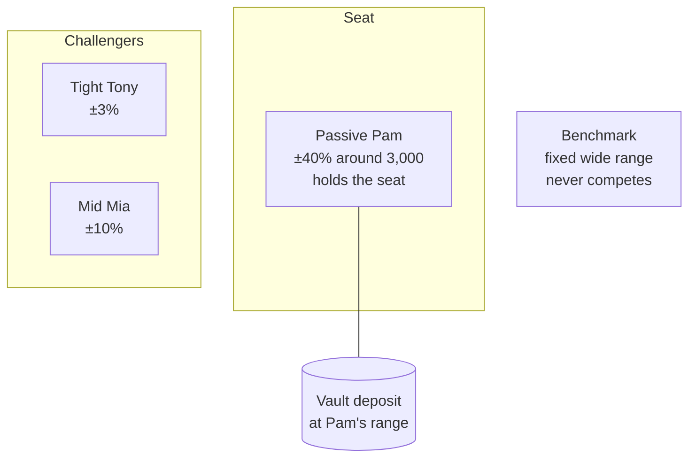

<Info>Status on 27 Nov 2026: epoch 12 reached, every ended epoch settled automatically by the keeper, zero debt on the reactive contract.</Info>

## Contracts

| Contract | Chain | Address |
|---|---|---|
| **OorkaHook** (hook, vault, curator registry) | Unichain Sepolia (1301) | [`0xbeEcbe71d831880f2038Bc35b613e100F1f010A0`](https://sepolia.uniscan.xyz/address/0xbeEcbe71d831880f2038Bc35b613e100F1f010A0) |
| **OorkaKeeper** (callback receiver, settles epochs) | Unichain Sepolia | [`0x53b31469cf03ae9f0042c7d6cbeed46750e22da5`](https://sepolia.uniscan.xyz/address/0x53b31469cf03ae9f0042c7d6cbeed46750e22da5) |
| **OorkaPulse** (event-driven, reacts to pool swaps) | Reactive Lasna | [`0xdbb33964d494e7cabfb90656d682f3b09f42ba9d`](https://lasna.reactscan.net/address/0xdbb33964d494e7cabfb90656d682f3b09f42ba9d) |
| **OorkaKeeper (Pulse)** | Unichain Sepolia | [`0xcfb0d5e9f4c4935782fd4d24d5d77af62919bf97`](https://sepolia.uniscan.xyz/address/0xcfb0d5e9f4c4935782fd4d24d5d77af62919bf97) |
| **OorkaReactive** (CRON fallback) | Reactive Lasna | [`0x86c807a7a56c63472d52c46ebd2441d2067d7450`](https://lasna.reactscan.net/address/0x86c807a7a56c63472d52c46ebd2441d2067d7450) |
| Uniswap v4 PoolManager | Unichain Sepolia | [`0x00b036b58a818b1bc34d502d3fe730db729e62ac`](https://sepolia.uniscan.xyz/address/0x00b036b58a818b1bc34d502d3fe730db729e62ac) |
| tETH (token0) | Unichain Sepolia | [`0x64A3C35b31f04e3c92a45E9d003468e4574810e6`](https://sepolia.uniscan.xyz/address/0x64A3C35b31f04e3c92a45E9d003468e4574810e6) |
| tUSD (token1) | Unichain Sepolia | [`0xaCB1732744aa55ff155E9BCA3F5B809b60C1Ac5C`](https://sepolia.uniscan.xyz/address/0xaCB1732744aa55ff155E9BCA3F5B809b60C1Ac5C) |
| Swap router (PoolSwapTest) | Unichain Sepolia | `0xa93b93a962d8b00d409f084f2262c0a773b2e0dd` |
| Reactive callback proxy | Unichain Sepolia | `0x775c9B990ADe401060B78D0e98684eEf8d2466C1` |

All addresses are also in [`frontend/public/deployments.1301.json`](https://github.com/debojyoti10CC/oorka/blob/main/frontend/public/deployments.1301.json), which the app reads at startup.

## The pool

| Property | Value |
|---|---|
| Pair | tETH / tUSD |
| Starting price | about 3,000 tUSD per tETH |
| Fee | 0.30% (`3000`) |
| Tick spacing | 60 |
| Hook | OorkaHook (bound in `afterInitialize`) |
| Deploy block | 68,873,661 |

## Seeded world

## What keeps it alive

<CardGroup cols={2}>
  <Card title="Oorka Pulse" icon="zap" href="/keeper/pulse">
    The first swap after an epoch ends triggers settlement within seconds. The CRON keeper (about every 17 minutes) is the fallback.
  </Card>
  <Card title="Demo market" icon="activity" href="/app/demo-market">
    A GitHub Action trades the pool four times an hour so curators have real swaps to be scored on.
  </Card>
</CardGroup>

<Frame caption="OorkaReactive on Reactscan Lasna: reactive executions and callbacks, zero debt.">
  
</Frame>
