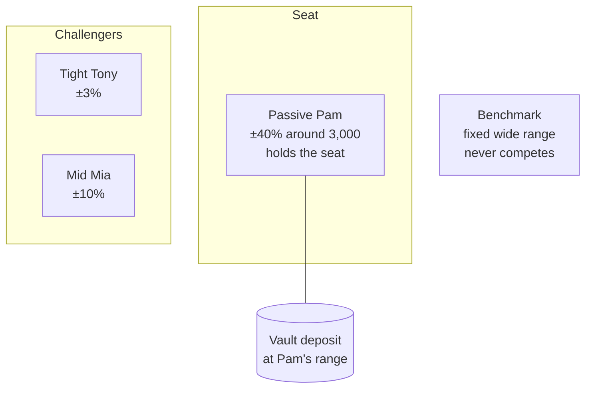

<Info>Live on real testnet assets since 28 Nov 2026: Circle's USDC and canonical WETH on Unichain Sepolia. The first deployment (test tokens, 26–28 Nov) settled 158 epochs with no human transaction, including 17 takeovers, 16 performance fees and 20 vault migrations.</Info>

## Contracts

| Contract | Chain | Address |
|---|---|---|
| **OorkaHook** (hook, vault, curator registry) | Unichain Sepolia (1301) | [`0xd3F75e4DF6d0Cd75B17B66d577216f1F0630d0A0`](https://sepolia.uniscan.xyz/address/0xd3F75e4DF6d0Cd75B17B66d577216f1F0630d0A0) |
| **OorkaKeeper** (callback receiver, settles epochs) | Unichain Sepolia | [`0x75f6f1d2d9e3f0d321cccdf8502d9813df4d3241`](https://sepolia.uniscan.xyz/address/0x75f6f1d2d9e3f0d321cccdf8502d9813df4d3241) |
| **OorkaPulse** (event-driven, reacts to pool swaps) | Reactive Lasna | [`0x0ee3b94d3eaa4b99c8c9840f3ab6139bbd9633aa`](https://lasna.reactscan.net/address/0x0ee3b94d3eaa4b99c8c9840f3ab6139bbd9633aa) |
| **OorkaKeeper (Pulse)** | Unichain Sepolia | [`0x6716dad1ad8a91ce35b368466948d25efe48e3ee`](https://sepolia.uniscan.xyz/address/0x6716dad1ad8a91ce35b368466948d25efe48e3ee) |
| **OorkaReactive** (CRON fallback) | Reactive Lasna | [`0xdf4a40dd91683a72cea16175b40bbba2d9b48a3e`](https://lasna.reactscan.net/address/0xdf4a40dd91683a72cea16175b40bbba2d9b48a3e) |
| Uniswap v4 PoolManager | Unichain Sepolia | [`0x00b036b58a818b1bc34d502d3fe730db729e62ac`](https://sepolia.uniscan.xyz/address/0x00b036b58a818b1bc34d502d3fe730db729e62ac) |
| USDC (token0, Circle) | Unichain Sepolia | [`0x31d0220469e10c4E71834a79b1f276d740d3768F`](https://sepolia.uniscan.xyz/address/0x31d0220469e10c4E71834a79b1f276d740d3768F) |
| WETH (token1, canonical) | Unichain Sepolia | [`0x4200000000000000000000000000000000000006`](https://sepolia.uniscan.xyz/address/0x4200000000000000000000000000000000000006) |
| Swap router (PoolSwapTest) | Unichain Sepolia | `0xa93b93a962d8b00d409f084f2262c0a773b2e0dd` |
| Reactive callback proxy | Unichain Sepolia | `0x775c9B990ADe401060B78D0e98684eEf8d2466C1` |

All addresses are also in [`frontend/public/deployments.1301.json`](https://github.com/debojyoti10CC/oorka/blob/main/frontend/public/deployments.1301.json), which the app reads at startup.

## The pool

| Property | Value |
|---|---|
| Pair | USDC / WETH (real testnet tokens, no mocks) |
| Starting price | about 3,000 USDC per WETH |
| Fee | 0.30% (`3000`) |
| Tick spacing | 60 |
| Hook | OorkaHook (bound in `afterInitialize`) |
| Deploy block | 68,873,661 |

## Seeded world

## What keeps it alive

<CardGroup cols={2}>
  <Card title="Oorka Pulse" icon="zap" href="/keeper/pulse">
    The first swap after an epoch ends triggers settlement within seconds. The CRON keeper (about every 17 minutes) is the fallback.
  </Card>
  <Card title="Market maker" icon="activity" href="/app/market-maker">
    A GitHub Action trades the pool four times an hour so curators have real swaps to be scored on.
  </Card>
</CardGroup>

<Frame caption="OorkaReactive on Reactscan Lasna: reactive executions and callbacks, zero debt.">
  
</Frame>
