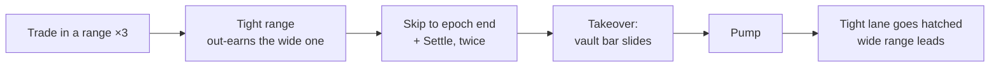

<Tabs>
  <Tab title="Live testnet (no install)">
    <Steps>
      <Step title="Open the app">
        Go to [debojyoti10cc.github.io/oorka](https://debojyoti10cc.github.io/oorka/) and open the **Arena**. It reads the live hook on Unichain Sepolia without a wallet.
      </Step>
      <Step title="Connect a wallet">
        Connect any browser wallet. The app switches you to Unichain Sepolia (chain id `1301`). You need a little Sepolia ETH on Unichain for gas.
      </Step>
      <Step title="Mint test tokens">
        tETH and tUSD are open-mint test tokens. Mint from the app; there is no faucet to wait on.
      </Step>
      <Step title="Do something">
        - **Swap** through the hooked pool and watch which curators your fee scores.
        - **Deposit** into the vault and compare it against the benchmark.
        - **Curate**: post a 100 tUSD bond, pick a range and enter the competition.
      </Step>
      <Step title="Watch it settle">
        Epochs last 15 minutes. The Reactive keeper settles each one within about 17 minutes. The **On-chain record** lists every settlement and takeover.
      </Step>
    </Steps>
  </Tab>
  <Tab title="Local demo (Foundry)">
    Needs [Foundry](https://book.getfoundry.sh/getting-started/installation) and Node 18+.

    ```bash
    git clone https://github.com/debojyoti10CC/oorka
    cd oorka
    ./demo.sh
    ```

    Then open `http://localhost:5173`. The script:

    1. starts a local anvil chain
    2. deploys a PoolManager, tETH/tUSD, swap and liquidity routers, and the hook at a flag-mined CREATE2 address
    3. creates a tETH/tUSD pool near 3,000 with deep background liquidity
    4. seeds three curators (Passive Pam ±40% holds the seat, Tight Tony ±3%, Mid Mia ±10%), a wide benchmark and a vault deposit
    5. starts the frontend with time controls

    <Tip>The local app signs with anvil dev keys, so there are no wallet popups. Use **Acting as** to switch between the depositor, fresh challengers and the seeded curators.</Tip>
  </Tab>
  <Tab title="Local demo (Node only)">
    For machines where forge or anvil can't run. A Hardhat devnet plays anvil's role and contracts come prebuilt from CI.

    ```bash
    # 1. devnet on :8545
    cd local-chain && npm install && npm run node

    # 2. second terminal: download CI artifacts and deploy the local world
    gh run download -R debojyoti10CC/oorka -n contracts-out -D ../ci-out
    cd frontend && npm install && node scripts/deploy-local.mjs ../ci-out

    # 3. dashboard with Hardhat-aware time controls
    npx vite --mode hardhat
    ```
  </Tab>
</Tabs>

## A two-minute demo script



1. Click **Trade in a range** a few times. The tight curator's paper NAV climbs faster than the wide one's.
2. Settle two epochs. The streak pips fill, then the takeover message appears and the vault bar jumps to the winner's range. The slashed bond shows in the on-chain record.
3. Click **Pump**. The price leaves the tight range, its lane goes hatched (earning nothing), and the wide range leads the next epoch.
