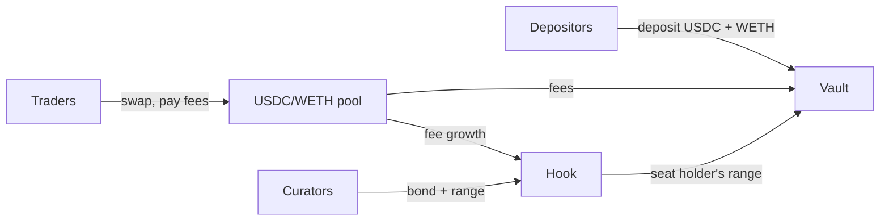

Oorka has three kinds of participants. Each one only needs the app and a wallet.

## Depositors

<Steps>
  <Step title="Deposit">
    Open **Vault**, enter WETH and USDC amounts and deposit. Liquidity is added at the current seat holder's range; any amount that doesn't fit the range stays in your wallet. You receive ERC20 vault shares.
  </Step>
  <Step title="Let the competition work">
    You don't pick a manager. Whoever holds the seat runs the vault. If a challenger beats them for two epochs in a row, your liquidity moves to the new range automatically and 20% of the old seat holder's bond is paid into the vault.
  </Step>
  <Step title="Check vault vs benchmark">
    The Vault page shows the vault's growth next to a passive benchmark range, since the start and for the current epoch. Every settlement also emits this on-chain as `BenchmarkScored`.
  </Step>
  <Step title="Withdraw">
    Burn shares for your pro-rata share of the vault position plus idle balances. Withdrawals price at the block-open price and revert during a price push, so nobody can sandwich you.
  </Step>
</Steps>

## Curators

<Steps>
  <Step title="Register">
    Open **Curate**, name yourself, pick a range and post a bond in WETH (at least the pool's minimum). The hook places a dust probe at your ticks and gives you a paper portfolio that starts at an index of 1,000.
  </Step>
  <Step title="Qualify">
    You must be present for a whole epoch before your results count. The epoch you join in is a qualifying epoch.
  </Step>
  <Step title="Win">
    Beat the seat holder's epoch return by more than 0.1% and you gain a win. Two wins in a row and you take the seat; the vault follows your range.
  </Step>
  <Step title="Adjust or exit">
    Move your range at any time (it costs 0.3% of paper NAV). Exit to reclaim your bond. The seat holder cannot exit; they must lose the seat first.
  </Step>
</Steps>

<Warning>As seat holder, moving your range also moves the vault's real liquidity, and the move reverts if the price is being pushed. Losing the seat costs 20% of your bond.</Warning>

## Traders

Swap USDC and WETH on the **Swap** page. Quotes are simulated exactly against the live pool. The hook never changes swap pricing: you pay the normal 0.30% LP fee, which goes to in-range liquidity, and every swap feeds the fee growth that curators are scored on.

<Frame caption="The Swap page shows which curators' ranges your swap is scored into.">
  
</Frame>
