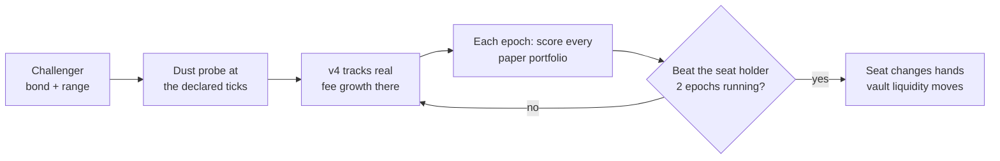

Oorka is a Uniswap v4 hook that turns the manager seat of a liquidity vault into a competition that settles itself. Any challenger can post a bond and declare a price range. The hook measures what that range **would have earned** on the pool's real swaps, compares it with the current seat holder every epoch, and hands over the seat, and the vault's real liquidity, to whoever keeps winning.

One system does three jobs that usually need three products and a governance forum: it curates strategists, forward-tests their strategies on live flow, and migrates capital to whoever is winning.

## The problem

Curated LP vaults ask depositors to trust a manager. You pick one on marketing, or on a backtest they ran themselves over data they chose. Nothing on-chain says *this manager is actually better than the alternatives right now*, and nothing replaces a bad one without governance.

## The idea in one diagram

## Why it matters

<CardGroup cols={2}>
  <Card title="Proof, not a pitch deck" icon="badge-check">
    Every score comes from v4's own `feeGrowthInside` at the declared ticks. Nobody self-reports a backtest; the pool measures the forward test.
  </Card>
  <Card title="Earn the seat, earn the fee" icon="coins">
    The seat holder earns 10% of vault growth above a passive benchmark and the high-water mark. Nothing for losses, nothing for matching doing nothing.
  </Card>
  <Card title="Hard to game" icon="shield">
    Block-open pricing, a time-weighted settle price, blocked donations and deviation guards on every vault move.
  </Card>
  <Card title="Nobody runs it" icon="zap">
    A Reactive Network CRON contract settles every epoch. Takeover and vault migration happen in a single transaction.
  </Card>
</CardGroup>

## By the numbers

| | |
|---|---|
| **61 tests + 5 invariants** | Unit, fuzz, stateful invariant, Reactive keeper and Pulse suites, all green in CI |
| **0** | Oracles, owners, admin keys or off-chain services in the hook |
| **1e9** | Liquidity per probe position: dust, but enough to make v4 track fees at those ticks |
| **10%** | Seat holder's cut, paid only on growth above the benchmark and high-water mark |
| **15 min** | Epoch length on the live testnet deployment |

## Compared

| | Typical vault manager | Auction-managed AMM | **Oorka** |
|---|---|---|---|
| Who gets the seat | Whoever launched the vault | Highest rent bidder | **Best measured LP performance** |
| Evidence | Self-reported backtest | Willingness to pay | **v4 fee growth at the declared ticks** |
| Replacing a bad manager | Governance or withdraw | Outbid them | **Automatic after a win streak** |
| Manager pay | Flat fee | Keeps arbitrage | **10% above benchmark + high-water** |

## Start here

<CardGroup cols={3}>
  <Card title="Quickstart" icon="rocket" href="/getting-started/quickstart">
    Use the live app or run the full local demo in one command.
  </Card>
  <Card title="Architecture" icon="network" href="/protocol/architecture">
    How the hook, the PoolManager and the keeper fit together.
  </Card>
  <Card title="Security model" icon="shield-check" href="/security/threat-model">
    Every attack we considered and the defence in code.
  </Card>
  <Card title="Epoch lifecycle" icon="refresh-cw" href="/protocol/epoch-lifecycle">
    What happens from declaration to takeover.
  </Card>
  <Card title="Contract reference" icon="file-code" href="/contracts/oorka-hook">
    Every function, event, error and parameter.
  </Card>
  <Card title="Reactive keeper" icon="timer" href="/keeper/overview">
    How epochs settle with nobody watching.
  </Card>
</CardGroup>
