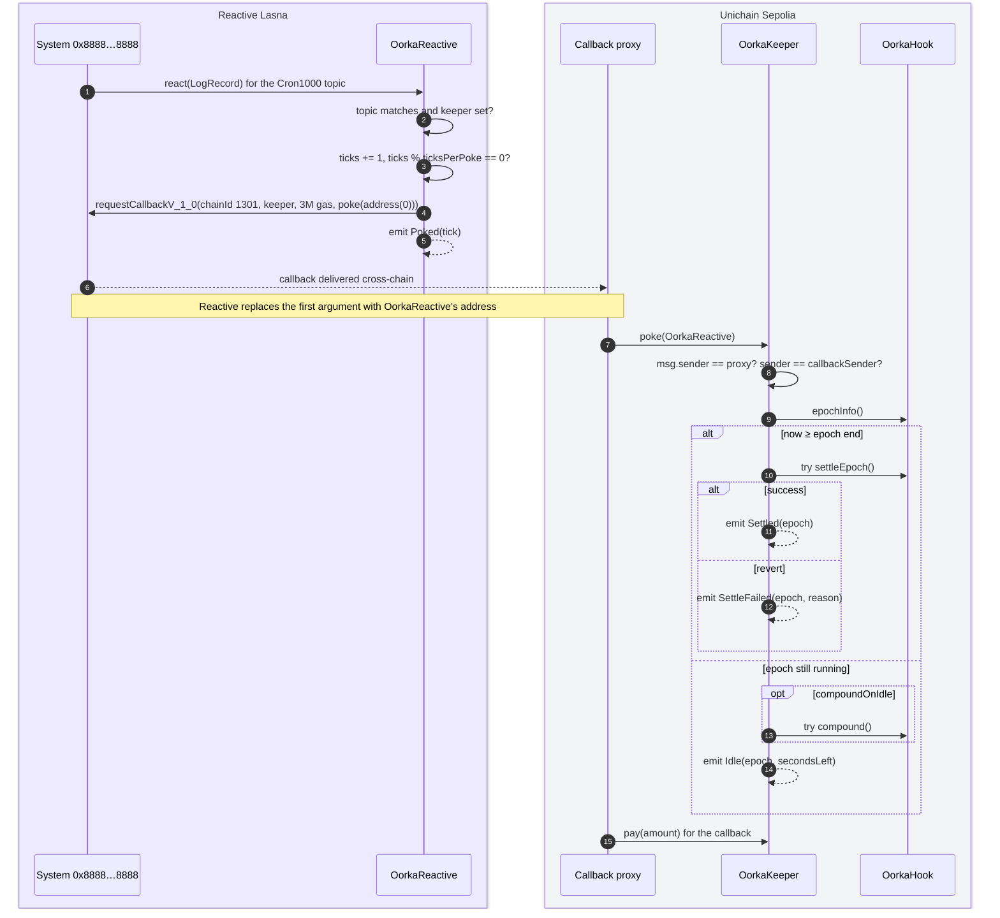
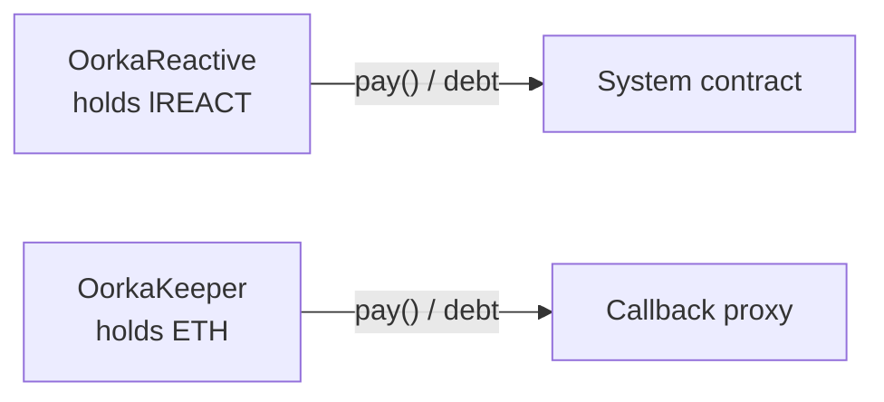

## Authentication, twice

<Steps>
  <Step title="Who is calling?">
    `onlyProxy`: `msg.sender` must be the Reactive callback proxy for this chain. Anything else reverts with `NotAuthorized(sender)`.
  </Step>
  <Step title="On whose behalf?">
    The proxy delivers callbacks for every reactive contract on the network. Reactive overwrites the first argument of the payload with the address of the reactive contract that requested it. The keeper checks it equals `callbackSender`, fixed at construction, else `CallbackNotAuthorized(sender, expected)`.
  </Step>
</Steps>

## Billing

- Each reactive transaction is billed to `OorkaReactive` in lREACT (about 0.013 per tick on Lasna).
- Each callback is billed to `OorkaKeeper` in ETH on Unichain.
- A contract in debt receives nothing. `coverDebt()` pays outstanding debt from the contract's balance; anyone can call it after funding the contract.
