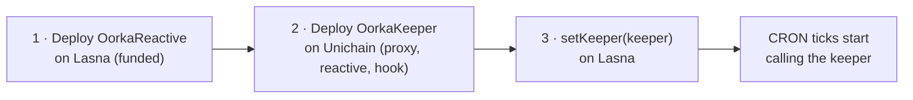

The keeper authenticates the reactive contract immutably, so the reactive contract is deployed first and pointed at the keeper afterwards with a one-shot `setKeeper`.



<Tabs>
  <Tab title="Node script (uses CI artifacts)">
    ```bash
    gh run download -R debojyoti10CC/oorka -n contracts-out -D ci-out
    cd frontend
    PRIVATE_KEY=0x... node scripts/deploy-reactive.mjs ../ci-out
    ```

    | Env var | Default | Meaning |
    |---|---|---|
    | `CRON` | `1000` | CRON variant: `100` (~2 min) or `1000` (~17 min) |
    | `REACTIVE_FUNDING` | `0.35` | lREACT sent with the reactive deployment |

    The script writes `keeper` and `reactive` into `public/deployments.1301.json`.
  </Tab>
  <Tab title="Foundry">
    ```bash
    cd contracts

    # 1. reactive contract on Lasna: Cron1000, destination 1301, poke every tick
    forge create src/reactive/OorkaReactive.sol:OorkaReactive --broadcast \
      --rpc-url https://lasna-rpc.rnk.dev/ --private-key $PRIVATE_KEY --value 0.35ether \
      --constructor-args 0xe20b31294d84c3661ddc8f423abb9c70310d0cf172aa2714ead78029b325e3f4 1301 1

    # 2. keeper on Unichain Sepolia: callback proxy, reactive contract, hook, compoundOnIdle
    forge create src/reactive/OorkaKeeper.sol:OorkaKeeper --broadcast \
      --rpc-url https://sepolia.unichain.org --private-key $PRIVATE_KEY --value 0.003ether \
      --constructor-args 0x775c9B990ADe401060B78D0e98684eEf8d2466C1 $REACTIVE $HOOK false

    # 3. point the reactive contract at the keeper
    cast send $REACTIVE "setKeeper(address)" $KEEPER \
      --rpc-url https://lasna-rpc.rnk.dev/ --private-key $PRIVATE_KEY
    ```
  </Tab>
</Tabs>

<Tip>Pick the longest CRON interval that still fits your epoch length. Every tick is billed whether or not anything settles.</Tip>

Callback proxy addresses and CRON topics are listed in the [Reactive docs](https://dev.reactive.network/origins-and-destinations). Check them before deploying.
