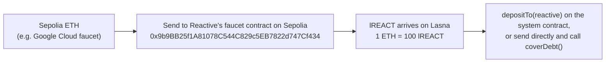

## Health check

| Check | Where | Healthy |
|---|---|---|
| Reactive balance and debt | [Reactscan: OorkaReactive](https://lasna.reactscan.net/address/0x86c807a7a56c63472d52c46ebd2441d2067d7450) | Balance > 0, debt 0 |
| Callbacks executing | Reactscan "Callbacks" tab | Count grows about every 17 min |
| Settlements | Keeper events on Uniscan, or the app's On-chain record | One `Settled` per epoch |
| Keeper ETH | [Uniscan: OorkaKeeper](https://sepolia.uniscan.xyz/address/0x53b31469cf03ae9f0042c7d6cbeed46750e22da5) | Enough for callback fees |

<Frame caption="Reactscan shows the reactive contract's balance, debt, executions and callbacks.">
  
</Frame>

## Burn rate

About 0.013 lREACT per tick. At one tick every ~17 minutes that is roughly 1.1 lREACT per day. The live deployment started with 4.6 lREACT.

## Getting lREACT



## Pause and resume

```bash
# stop CRON billing
cast send $REACTIVE "setPaused(bool)" true --rpc-url https://lasna-rpc.rnk.dev/ --private-key $PRIVATE_KEY

# resume: pays any debt first, then resubscribes
cast send $REACTIVE "setPaused(bool)" false --rpc-url https://lasna-rpc.rnk.dev/ --private-key $PRIVATE_KEY
```

## If the keeper stops

Nothing breaks. Epochs simply wait. Anyone can call `settleEpoch()` on the hook (the app's **Settle** button does exactly that), and the keeper resumes on its next tick once funded.

## History

The first keeper was built on the older reactive-lib model, where `react()` was guarded by `vmOnly`. After Reactive moved to the current model (system contract calls `react()` directly; callbacks via `requestCallbackV_1_0`), it reverted with "VM only". It was ported, redeployed, and the old contract paused.
