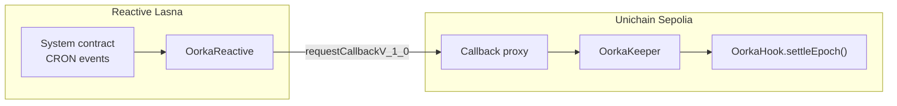

`settleEpoch()` is permissionless, but somebody still has to call it. Oorka removes that somebody with Reactive Network, in two layers:

- **[Oorka Pulse](/keeper/pulse)** reacts to the pool's own swaps and settles within seconds of an epoch ending.
- **The CRON keeper** below wakes up on a timer and settles whatever Pulse hasn't, so a quiet pool still settles.

This page covers the CRON keeper.

<CardGroup cols={2}>
  <Card title="OorkaReactive" icon="radio" href="/contracts/oorka-reactive">
    Subscribes to a CRON topic. Every `ticksPerPoke` ticks it asks Reactive Network to call the keeper with `poke(address)`.
  </Card>
  <Card title="OorkaKeeper" icon="timer" href="/contracts/oorka-keeper">
    Accepts only the callback proxy and only our reactive contract. Settles if the epoch ended, otherwise emits `Idle`.
  </Card>
</CardGroup>

## Design principles

- **No special rights.** The keeper calls the same public `settleEpoch()` as anyone. If it stops, anyone can settle by hand.
- **Never wedge the schedule.** A failed settle is caught and reported (`SettleFailed`); the next tick retries.
- **Cheap filters.** `react()` returns quietly on unrelated logs instead of reverting, because reverted reactive transactions are still billed.
- **Off switch.** `setPaused(true)` unsubscribes from CRON so ticks stop billing.
- **Gas budget.** A full takeover settle uses under 1.5M gas, half of the 3M callback limit (checked in tests).

## Live configuration

| Setting | Value |
|---|---|
| CRON topic | Cron1000 `0xe20b31294d84c3661ddc8f423abb9c70310d0cf172aa2714ead78029b325e3f4` |
| Tick interval | about 17 minutes |
| `ticksPerPoke` | 1 |
| Destination chain | 1301 (Unichain Sepolia) |
| Callback gas limit | 3,000,000 |
| Epoch length | 15 minutes |
| `compoundOnIdle` | false |

Because a tick (about 17 min) is longer than an epoch (15 min), every tick finds an ended epoch and settles it.
