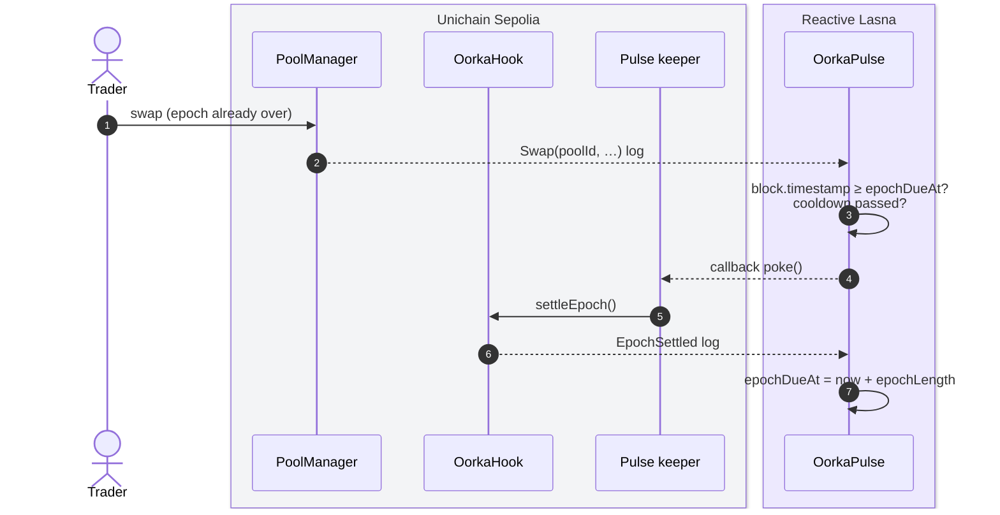
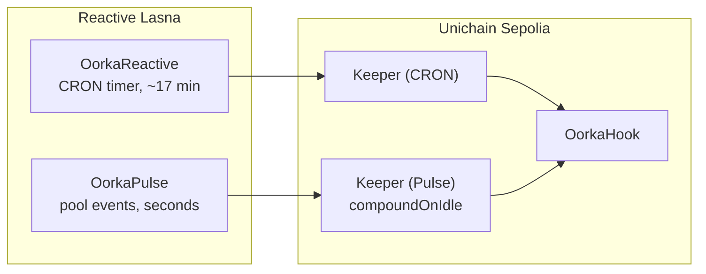

The CRON keeper settles on a timer, so an ended epoch can wait up to one tick (about 17 minutes) before the seat changes hands. **Oorka Pulse** removes that wait. It listens to the pool itself on Reactive Network and calls back the moment there is work to do.



## What it listens to

| Event | Emitter | What Pulse does |
|---|---|---|
| `Swap(PoolId indexed id, …)` filtered to Oorka's pool | v4 PoolManager | If the epoch is due, or a vault move is pending, and the cooldown has passed: request a callback |
| `EpochSettled` | OorkaHook | Reset its epoch clock: `epochDueAt = now + epochLength` |
| `VaultMoveDeferred` | OorkaHook | Set `vaultMovePending` |
| `VaultMoved` | OorkaHook | Clear `vaultMovePending` |

## Two jobs

<CardGroup cols={2}>
  <Card title="Settle on time" icon="timer">
    The first swap after an epoch boundary triggers settlement. The seat changes hands seconds after the epoch closes, not at the next CRON tick.
  </Card>
  <Card title="Finish deferred moves" icon="move-right">
    A takeover during a price push leaves the vault behind (`VaultMoveDeferred`). The next swap triggers a callback; the keeper calls `compound()`, which moves the vault at an honest price.
  </Card>
</CardGroup>

## Measured latency

<Info>Numbers below come from `frontend/scripts/pulse-latency.mjs`, which pairs every `Triggered` event on Lasna with its origin swap and its callback on Unichain, using block timestamps from both chains.</Info>

| Loop | Origin swap | Reactive tx (Lasna) | Callback | Origin to callback |
|---|---|---|---|---|
| Epoch due, settled | `0x1059affe…d603` | `0x2c2a0652…672c` | `0x306dd6f7…dd54` (`Settled`) | **2 s** |

CRON fallback for comparison: up to one tick, about 17 minutes.

```bash
cd frontend && node scripts/pulse-latency.mjs
```

## Safeguards

| Risk | Safeguard |
|---|---|
| A burst of swaps requests a burst of callbacks | `cooldown` (30 s): at most one request per window |
| Logs from another pool, chain or contract | Ignored by explicit checks on chain id, emitter and `poolId`, without reverting |
| Pulse misfires | It only calls the same `poke()` the CRON keeper uses; the hook re-checks the epoch end and the price deviation itself |
| Pulse stops (out of funds, paused) | The CRON keeper keeps running independently; `settleEpoch()` stays permissionless |
| Quiet pool with no swaps | Nothing to react to; the CRON keeper settles on its next tick |
| Owner key | Can only pause or resume subscriptions; cannot move funds or change scores |

## Two keepers, side by side



Both keepers are the same `OorkaKeeper` contract. Each one trusts exactly one reactive sender. Whichever arrives first after an epoch ends settles it; the other sees a fresh epoch and goes idle.

## Deploy

```bash
gh run download -R debojyoti10CC/oorka -n contracts-out -D ci-out
cd frontend
node scripts/deploy-pulse.mjs ../ci-out    # PULSE_FUNDING, KEEPER_FUNDING_ETH, COOLDOWN optional
```
