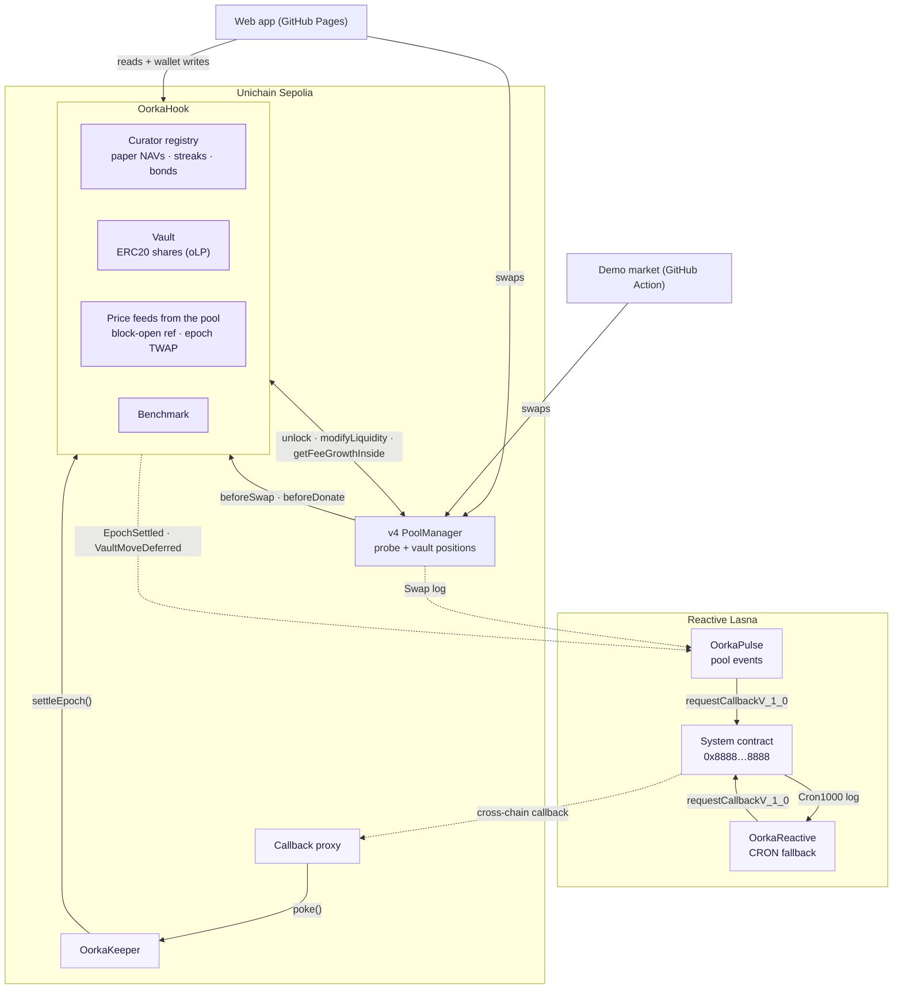
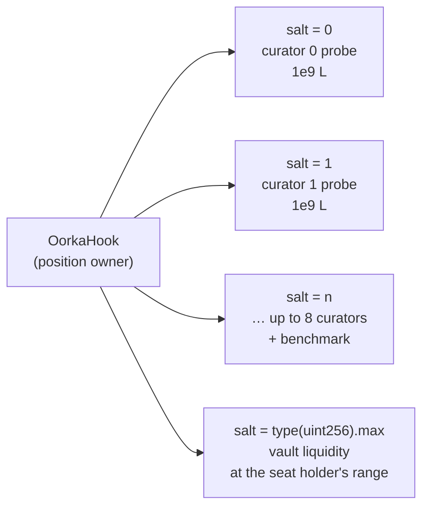

Oorka is three contracts and an app. The hook does all the economics; the two Reactive contracts only add liveness.

## Components

<AccordionGroup>
  <Accordion title="OorkaHook" icon="anchor">
    One contract that is simultaneously the v4 hook, the vault (an ERC20 share token called `oLP`) and the curator registry. It owns every position it creates in the PoolManager and separates them by salt. 1,028 lines, 24,358 bytes of runtime code, just under the 24,576-byte limit.
  </Accordion>
  <Accordion title="v4 PoolManager" icon="database">
    The standard Uniswap v4 singleton. Oorka relies on three things it already provides: salted positions, `getFeeGrowthInside` for any initialised range (through `StateLibrary`), and the unlock callback for atomic liquidity changes.
  </Accordion>
  <Accordion title="OorkaReactive" icon="radio">
    Lives on Reactive Lasna. Subscribes to a built-in CRON topic and, every N ticks, asks the network to call the keeper on Unichain.
  </Accordion>
  <Accordion title="OorkaPulse" icon="zap">
    Lives on Reactive Lasna. Subscribes to the pool's `Swap` events and the hook's settlement events. The first swap after an epoch ends triggers a keeper callback within seconds; a deferred vault move is finished on the next swap. See [Oorka Pulse](/keeper/pulse).
  </Accordion>
  <Accordion title="OorkaKeeper" icon="timer">
    Lives on Unichain next to the hook. Accepts calls only from the Reactive callback proxy, and only when the network-injected sender is our own reactive contract. Settles the epoch if it has ended.
  </Accordion>
  <Accordion title="Web app" icon="monitor">
    React + viem on GitHub Pages. Landing page, Arena, Vault, Curate, Swap and Docs. Reads history from the Blockscout logs API and new blocks over RPC.
  </Accordion>
  <Accordion title="Demo market" icon="activity">
    A scheduled GitHub Action that trades the public pool so the competition has real fee growth to score. It never settles.
  </Accordion>
</AccordionGroup>

## Hook permissions

The hook address is mined so its low bits encode exactly these flags:

| Permission | Why |
|---|---|
| `afterInitialize` | Bind the hook to exactly one pool (`PoolAlreadySet` on a second). |
| `beforeSwap` | On the first swap of each block, snapshot the block-open price and extend the time-weighted tick accumulator. Returns a zero delta and no fee override. |
| `beforeDonate` | Revert every donation (`DonationsDisabled`), which would otherwise add fee growth with no swap. |

The hook never changes swap pricing. Traders pay the pool's normal 0.30% fee.

## Positions inside the PoolManager

| Salt | Position |
|---|---|
| `bytes32(id)` | Curator `id`'s probe: `PROBE_LIQUIDITY = 1e9` at the declared range |
| `type(uint256).max` | The vault's real liquidity at the seat holder's range |

## Unlock actions

Every liquidity change goes through `poolManager.unlock` and comes back to `unlockCallback` with one of four actions:

| Action | Triggered by | Effect |
|---|---|---|
| `MOVE_PROBE` | `register`, `declareRange`, `exit`, `registerBenchmark` | Remove the old probe, add the new one; dust paid or refunded to the curator |
| `MOVE_VAULT` | seat holder's `declareRange`, takeover, `compound` | Pull vault liquidity, collect fees, redeploy at the seat holder's range |
| `DEPOSIT` | `deposit` | Add liquidity at the vault range, mint shares, refund what doesn't fit |
| `WITHDRAW` | `withdraw` | Burn shares, remove pro-rata liquidity plus idle balances |
