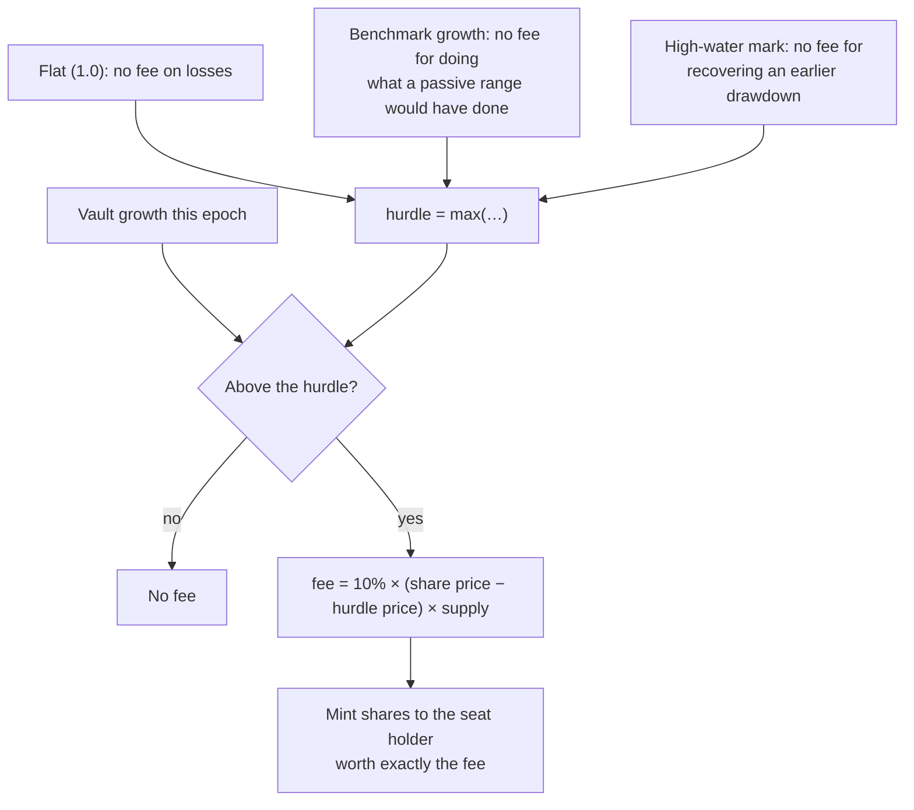

## The benchmark

`registerBenchmark(name, lower, upper)` creates a paper portfolio at a **fixed range**. It can be called once per hook, by anyone.

- No bond and no owner.
- It never moves, can't exit and can never take the seat.
- It doesn't use one of the 8 curator slots.
- It is scored every epoch with the same TWAP and the same fee data as everyone else.

Every settlement emits:

```solidity
event BenchmarkScored(uint256 indexed epoch, uint256 vaultGrowthWad, uint256 benchmarkGrowthWad);
```

`benchmarkReport()` returns vault vs benchmark growth since the start and for the current epoch, which the Vault page shows.

<Frame caption="The Vault page: deposit, withdraw, and vault vs benchmark.">
  
</Frame>

## The performance fee

The seat holder earns `perfFeeBps` (10%) of the value the vault created this epoch **above a hurdle**. The hurdle is the highest of three things:



The fee is paid by **minting vault shares**, not by moving tokens out of the pool:

```text
shares = fee · supply / (nav − fee)
```

so the seat holder's new shares are worth exactly `fee` and depositors are diluted by exactly that amount. It's charged before any takeover in the same settlement, so the seat holder is paid for the epoch they actually managed.

Event:

```solidity
event PerformanceFee(uint256 indexed epoch, uint256 indexed curatorId, address indexed to, uint256 shares, uint256 value);
```

## Example

| | Value |
|---|---|
| Vault growth this epoch | +1.73% |
| Benchmark growth | +0.70% |
| High-water hurdle | +0.00% |
| Excess over hurdle | 1.03% of vault value |
| Seat holder's fee | 10% of that, about 0.10% of vault value, as new shares |
