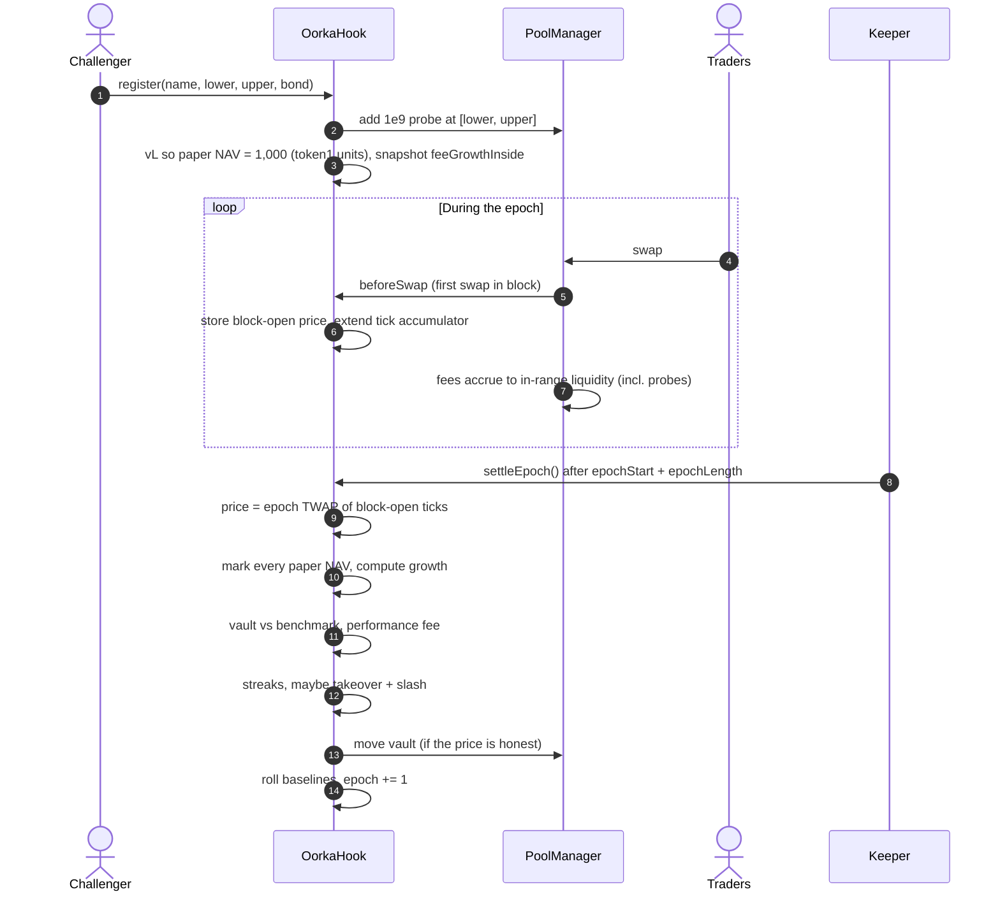
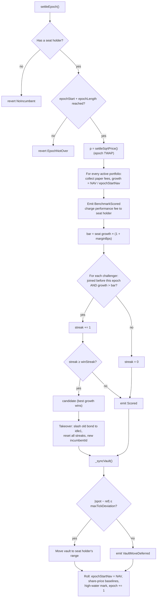
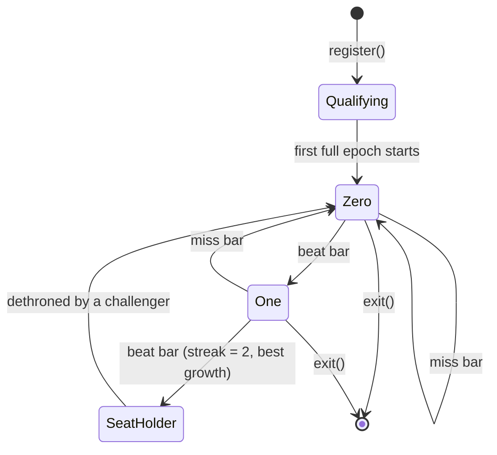

Time in Oorka is cut into epochs (`epochLength`, 15 minutes on testnet). Curators accrue paper results during an epoch; `settleEpoch()` closes it, scores everyone and possibly hands over the seat.

## One epoch, end to end

## Settlement logic

## Rules that matter

<CardGroup cols={2}>
  <Card title="Whole-epoch presence" icon="calendar-check">
    A challenger only gains a win if `joinedEpoch < epoch`. Joining mid-epoch never counts.
  </Card>
  <Card title="Margin" icon="percent">
    The challenger must beat the seat holder's growth by `marginBps` (0.1%), not just tie.
  </Card>
  <Card title="Streak" icon="flame">
    `winStreak` (2) consecutive wins. One losing epoch resets the streak to zero.
  </Card>
  <Card title="Clean slate" icon="eraser">
    On takeover every streak resets, including the new seat holder's challengers.
  </Card>
</CardGroup>

## Streak states for a challenger

