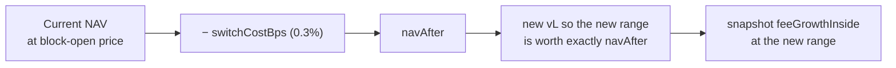

Every curator, the seat holder and the benchmark all get the same thing: a **paper portfolio** worth `INITIAL_NAV = 1,000` units of token1 (WETH on the live pool) at the moment their range is declared. It holds real price exposure and earns real fees, but no capital is at risk beyond the bond.

## The formula

```text
fees     = (feeGrowthInside_now − feeGrowthInside_last) · vL / 2^128
position = amounts(vL, [lower, upper], price)          // token0, token1 held by the range
NAV      = value(position + fees + cash, price)        // in token1 units
```

| Term | Meaning |
|---|---|
| `vL` | Virtual liquidity. Chosen at declaration so `NAV = 1,000` (or the carried-over NAV after a range change). |
| `feeGrowthInside` | Per-unit-of-liquidity fee growth for the range, from the probe (X128 fixed point). |
| `cash0`, `cash1` | Paper fees already collected at settlement but not reinvested. |
| `price` | Block-open price for live views; the epoch TWAP at settlement. |

## Changing range



The switch cost stands in for the real swap fees and slippage of rebalancing an actual position, so flipping ranges every block to chase fees is a losing strategy.

## Epoch growth

At settlement each portfolio's growth is

```text
growth = NAV(settle price) / epochStartNav          // WAD, 1e18 = flat
```

and after settlement `epochStartNav` is reset to the current NAV. Growth is what curators compete on: a curator who earned more fees *and* held up better against price moves wins.

## Worked example

<Steps>
  <Step title="Declare">
    Tight Tony declares 2,903–3,083 at price 3,000. `vL` is set so his portfolio starts at 1,000, roughly half in each token.
  </Step>
  <Step title="Ranging market">
    The price chops inside his range. Because his range is narrow, his `vL` is large, and the fee growth inside it multiplied by `vL` gives more fees than a wide range would get. His NAV rises faster than Passive Pam's.
  </Step>
  <Step title="Trending market">
    The price leaves 3,083. Tony's portfolio is now entirely in one token and earns nothing (his lane goes hatched in the app). A wide range keeps earning and holds the rising asset, so it now grows faster.
  </Step>
</Steps>
