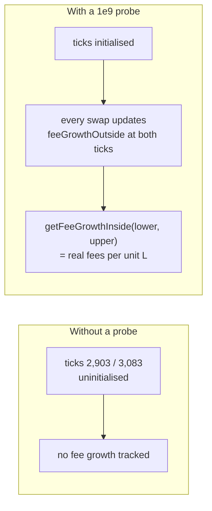

## The constraint

Uniswap v4 keeps per-tick fee growth only for **initialised ticks**: ticks that some position uses as a boundary. For an arbitrary range with no liquidity, `feeGrowthInside` is meaningless; nothing records what the range would have earned.

A challenger with no capital at their range would therefore have no measurable track record.

## The trick

When a curator declares `[lower, upper]`, the hook adds `PROBE_LIQUIDITY = 1e9` units of liquidity there, owned by the hook and salted `bytes32(id)`. That's dust in value (fractions of a cent at these prices) but it initialises both ticks. From then on the PoolManager maintains fee growth for that exact range on every swap, and

```solidity
(uint256 g0, uint256 g1) = poolManager.getFeeGrowthInside(poolId, lower, upper);
```

returns real, per-unit-of-liquidity fees earned by that range.



## Lifecycle of a probe

| Event | What happens to the probe |
|---|---|
| `register` | Added at the declared range. The curator pays the dust amounts. |
| `declareRange` | Removed from the old range, added at the new one, in one unlock. |
| `exit` | Removed; dust refunded to the curator. |
| `registerBenchmark` | The benchmark gets a probe like any curator, at a range that never moves. |

## Why this is honest

- The numbers come from the **same swaps** for every curator: there is no self-reported data.
- Fee growth per unit of liquidity is the same whether the range holds 1e9 or 1e24 liquidity, so scaling the probe's growth to a 1,000 tUSD portfolio is exact (see [Paper NAV](/protocol/paper-nav)).
- The invariant suite checks after every random action that each active curator's probe holds exactly `1e9` at its declared range.

<Note>Probes do earn a vanishingly small share of real fees, which stays in the hook. Their purpose is measurement, not income.</Note>
