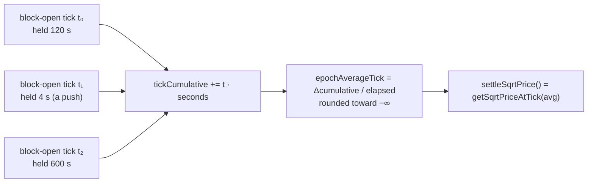

Oorka uses no external oracle. It builds two prices from the pool itself, both inside `beforeSwap`.

## Block-open reference price

On the first swap of every block, `beforeSwap` reads `slot0` **before** that swap executes and stores it as `refSqrtPriceStored` for the block.

```solidity
if (refBlock != block.number) {
    (uint160 sp, int24 tick,,) = poolManager.getSlot0(poolId);
    refSqrtPriceStored = sp;
    refBlock = block.number;
    tickCumulative += int256(lastObsTick) * int256(block.timestamp - lastObsTime);
    lastObsTick = tick;
    lastObsTime = block.timestamp;
}
```

`refSqrtPrice()` is used for live accounting: deposits, withdrawals, range changes and views. A swap later in the same block cannot move it, which defeats in-block flash manipulation.

## Epoch TWAP settle price

The same hook call extends a tick accumulator: each block-open tick is weighted by **how many seconds it held**.



`settleEpoch()` marks every portfolio at `settleSqrtPrice()`. A price pushed at the end of block N and "settled" first thing in block N+1 only contributes the few seconds it actually held, so it barely moves a 15-minute average.

## Which price is used where

| Action | Price | Guarded by deviation check |
|---|---|---|
| Live NAV views, standings | block-open ref | – |
| `deposit` / `withdraw` | block-open ref | yes |
| `declareRange` by the seat holder | block-open ref | yes |
| `declareRange` by a challenger | block-open ref | no (doesn't touch the vault) |
| `settleEpoch` scoring | epoch TWAP | – |
| Vault move after a takeover | – | yes, otherwise deferred |
| `compound` | – | yes |

## The deviation guard

```solidity
function _deviationOk() internal view returns (bool) {
    (, int24 spotTick,,) = poolManager.getSlot0(poolId);
    int24 refTick = TickMath.getTickAtSqrtPrice(refSqrtPrice());
    int24 diff = spotTick > refTick ? spotTick - refTick : refTick - spotTick;
    return diff <= config.maxTickDeviation;
}
```

If spot has moved more than `maxTickDeviation` ticks (300 on testnet, about 3%) from the block-open price within the current block, someone is pushing the price, and every action that moves real vault liquidity refuses to run (`PriceDeviation`), except settlement, which [defers the move](/protocol/takeover-and-vault#deferred-moves).
