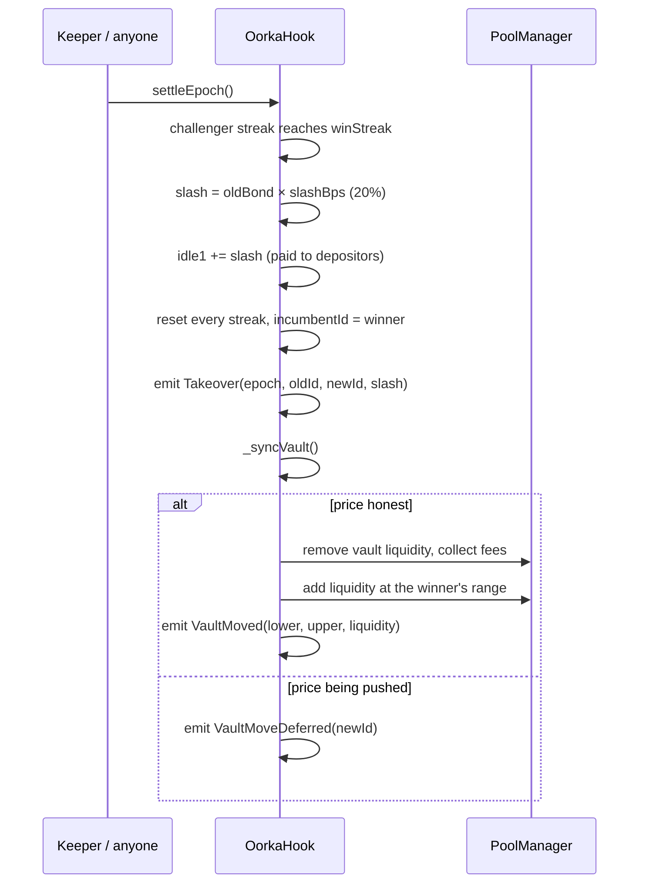
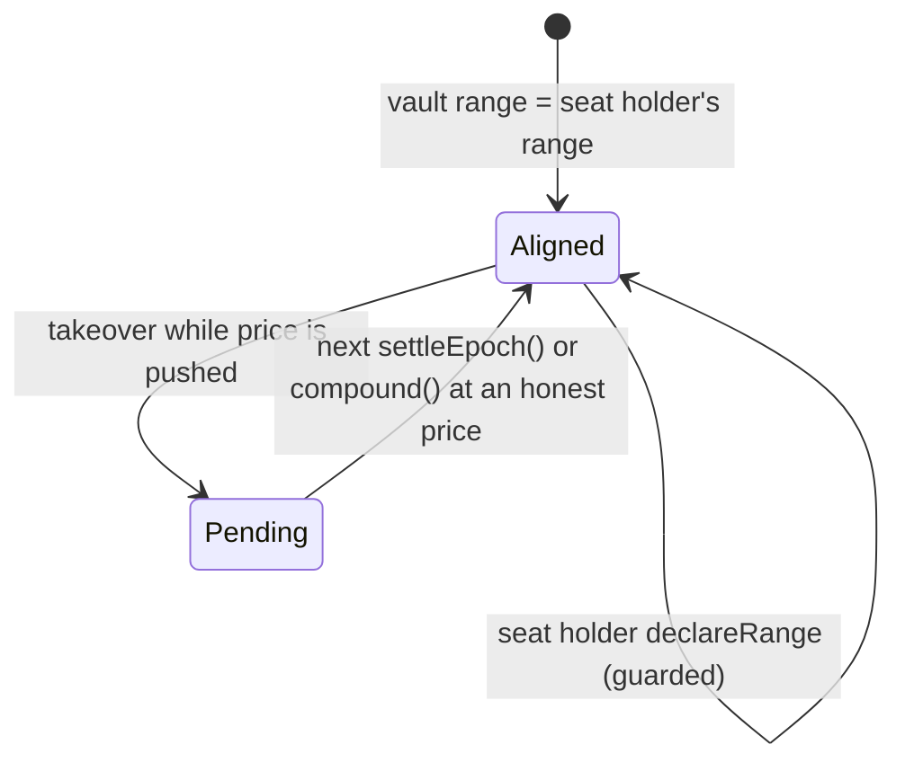

## The vault

The hook is also an ERC20 vault (`Oorka Vault Share`, symbol `oLP`, 18 decimals). Its liquidity always sits at the **seat holder's range**, in a single PoolManager position salted `type(uint256).max`.

| Function | What it does |
|---|---|
| `deposit(amount0Max, amount1Max, minShares)` | Adds as much liquidity as fits at the vault range, mints shares at the block-open share price, refunds the rest. Reverts on `Slippage`. |
| `withdraw(shares, min0, min1)` | Burns shares for a pro-rata slice of the position plus idle balances. |
| `compound()` | Permissionless. Collects fees and reinvests idle balances at the seat holder's range; also completes a deferred move. |

The first deposit mints `MIN_SHARES = 1,000` shares to `0xdead` to prevent share-price inflation attacks.

## Takeover

<Info>The dethroned seat holder keeps 80% of their bond and stays in the competition as a challenger. They can try to win the seat back or exit and reclaim what's left.</Info>

## Deferred moves

Settlement is permissionless, so an attacker could push the price, call `settleEpoch()` in the same block, and have the vault migrate into their sandwich. Oorka splits the two halves of a takeover:

1. **The seat always changes on time**, because the score is computed at the epoch TWAP, which a push barely moves.
2. **The vault only moves at an honest price.** `_syncVault()` checks the deviation guard. If it fails, it emits `VaultMoveDeferred` and returns; the next settlement or any `compound()` call finishes the move.

## Unmatched tokens

When the vault moves to a new range, the token ratio usually changes. Whatever doesn't fit the new range stays in `idle0` / `idle1` inside the hook and counts toward the share price. `compound()` reinvests it as far as the range allows.
