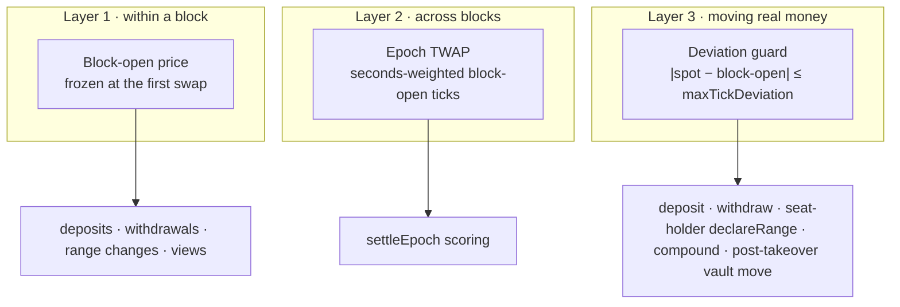

Oorka's scores depend on price, so every way to move the price cheaply has to be neutralised. There are three layers.

## Layer 1: block-open price

An attacker who swaps the price up and back inside one transaction or one block sees no effect: the price used for accounting was fixed before their first swap.

## Layer 2: epoch TWAP

Holding a pushed price across a block boundary costs real capital and arbitrage risk. Even if an attacker does it, the settle price is an average over the whole epoch weighted by seconds. On a 15-minute epoch, a push held for 2 seconds contributes about 0.2% of the weight.

## Layer 3: deviation guard

Whenever real vault liquidity moves, the hook compares spot with the block-open price. A gap of more than `maxTickDeviation` (300 ticks on testnet) means somebody is pushing the price inside this block:

- `deposit`, `withdraw`, `compound` and the seat holder's `declareRange` revert with `PriceDeviation`.
- A takeover inside `settleEpoch` still happens, but the vault move is deferred.

## Donations

`donate()` adds to fee growth without any swap. That would let a curator pay to inflate their own range's score. The hook claims the `beforeDonate` permission and always reverts with `DonationsDisabled`.

## What it costs to cheat

| Approach | Cost | Effect on score |
|---|---|---|
| Flash swap in one block | Fees only | None (block-open price) |
| Push and settle next block | Fees + holding risk | Weight of a few seconds in the TWAP |
| Donate to your range | – | Reverts |
| Wash trade through your range | Swap fees + impact on every trade; fees go to all real liquidity in range | Real but expensive; see [known limitations](/security/known-limitations) |
