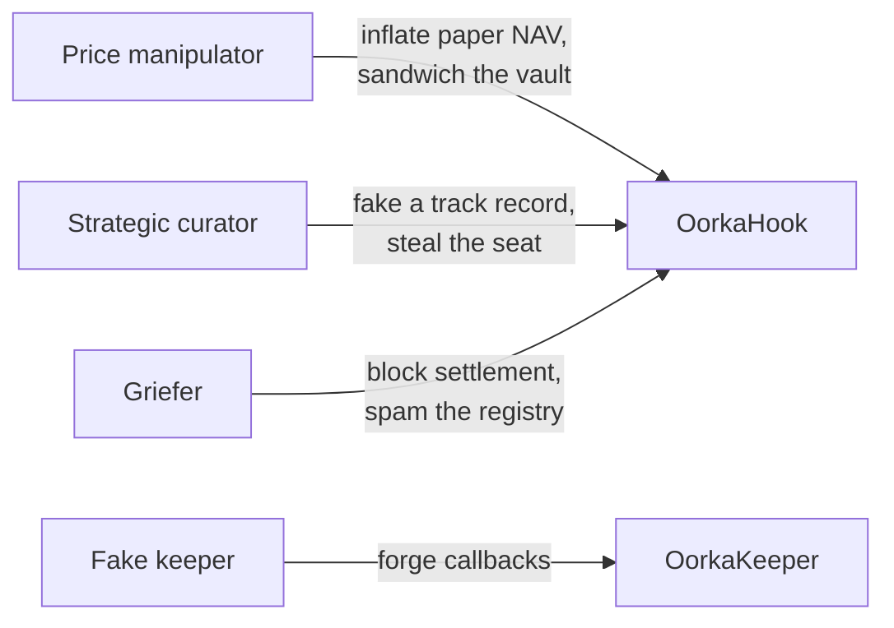

Oorka moves real liquidity based on scores anyone can influence by trading. The design assumes adversarial traders, adversarial curators and an adversarial settler.

## Actors and what they want

## Attacks and defences

| Attack | Defence | Test |
|---|---|---|
| Flash-swap the price to inflate a paper NAV right before settling | All live accounting uses the **block-open price**, snapshotted in `beforeSwap` on the first swap of each block | `test_referencePriceIgnoresInBlockManipulation` |
| Push the price at the end of block N, settle first thing in block N+1 | Settlement scores at the **epoch TWAP of block-open ticks**; a short push contributes only the seconds it held | `test_settlePriceIgnoresAPushAcrossTheBlockBoundary` |
| Sandwich a deposit, withdrawal or seat-holder rebalance | Vault-moving actions revert with `PriceDeviation` beyond `maxTickDeviation` ticks from block-open | covered across vault tests |
| Push the price, then call `settleEpoch()` so a takeover migrates the vault into the sandwich | The seat changes; the vault move waits (`VaultMoveDeferred`) for an honest price | `test_takeoverWaitsOutAPricePush` |
| Register and exit repeatedly until `settleEpoch()` runs out of gas | Exited slots are reused; the array never exceeds 8 curators + benchmark | `test_registerExitChurnReusesSlots`, `invariant_curatorArrayBounded` |
| Pump a range's score with `donate()` | `beforeDonate` reverts every donation | `test_donationsAreBlocked` |
| Declare a range after seeing where the price went | Ranges accrue only from the moment of declaration | by construction |
| Flip ranges every block to chase fees | `switchCostBps` charged on every change | by construction |
| Join late in an epoch with a lucky run | Must be present for the whole epoch (`joinedEpoch < epoch`) | `test_challengerTakesOverAfterStreak` |
| Spam the leaderboard | 100 tUSD minimum bond, max 8 curators | `test_bondTooSmall` |
| Carry wins earned against the old seat holder into the new reign | Every streak resets on takeover | `test_takeoverResetsEveryStreak` |
| Exit as seat holder to dodge the slash | `exit` reverts with `IsIncumbent` | `test_incumbentCannotExit` |
| Move someone else's range | `NotCuratorOwner` | `test_onlyOwnerDeclares` |
| Settle early | `EpochNotOver` | `test_cannotSettleEarly` |
| Forge a keeper callback | Keeper accepts only the Reactive proxy, and only our reactive contract as injected sender | `test_onlyCallbackProxy`, `test_onlyOurReactiveContract` |
| Drain the keeper's or reactive contract's balance | `pay` only callable by the proxy / system contract and only pays them | `test_keeperPaysOnlyTheProxy`, `test_reactivePaysTheSystemContract` |
| Inflate the vault share price on first deposit | 1,000 shares minted to `0xdead` on the first deposit | `testFuzz_depositWithdrawNeverCreatesValue` |

## Invariants that hold under random attack sequences

The [invariant suite](/development/testing#invariants) drives random trades, deposits, withdrawals, registrations, range changes, exits, time jumps and settlements, and checks after every step:

<CardGroup cols={2}>
  <Card title="Solvent" icon="scale">Token balances always cover idle vault funds plus every bond.</Card>
  <Card title="Books match the pool" icon="book-check">The vault's booked liquidity equals its PoolManager position.</Card>
  <Card title="Bounded" icon="ruler">The curator array never exceeds `MAX_CURATORS + 1`.</Card>
  <Card title="One seat holder" icon="crown">Exactly one live seat holder, never the benchmark.</Card>
  <Card title="Probes in place" icon="crosshair">Every active probe holds exactly `1e9` at its declared range.</Card>
</CardGroup>

## No privileged roles in the hook

The hook has no owner, no admin, no pause and no upgrade path. Configuration is fixed in the constructor. The only one-time action is `registerBenchmark`, open to anyone, once. The Reactive contracts have an owner only for `setKeeper` (one-shot) and `setPaused`, which can stop automatic settlement but never change scores or move funds; `settleEpoch()` stays callable by anyone.
